# Relatório 10 - Laboratório 10
**Arthur Choi Braga - 242014300**

Laboratório 10 - Firewall de pacotes sem estado (stateless)
Disciplina ENE0025 - Protocolos de Transporte e Roteamento

## Objetivo

Implementar um firewall *stateless* com `iptables` em uma máquina Ubuntu 24.04 posicionada entre duas redes, filtrando o tráfego por endereço IP, protocolo e porta.

## Parte 1 - Topologia

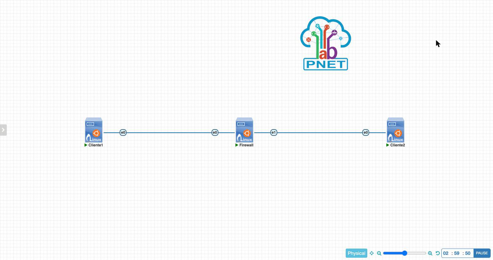

| Dispositivo | Interface | Endereço IP | Gateway |
| --- | --- | --- | --- |
| Cliente1 | ens3 | 192.168.10.10/24 | 192.168.10.1 |
| Firewall | ens3 | 192.168.10.1/24 | — |
| Firewall | ens4 | 192.168.20.1/24 | — |
| Cliente2 | ens3 | 192.168.20.10/24 | 192.168.20.1 |

## Parte 2 - Configuração IP

**Cliente1**

```bash
ip addr add 192.168.10.10/24 dev ens3
ip link set ens3 up
ip route add default via 192.168.10.1
```

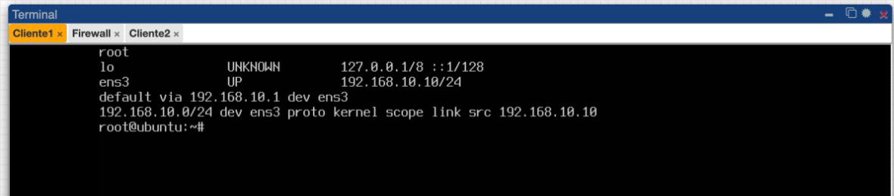

**Firewall**

```bash
ip addr add 192.168.10.1/24 dev ens3
ip addr add 192.168.20.1/24 dev ens4
ip link set ens3 up
ip link set ens4 up
sysctl -w net.ipv4.ip_forward=1     # também ativado em /etc/sysctl.conf
```

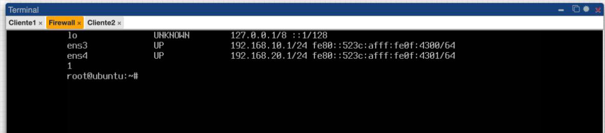

**Cliente2**

```bash
ip addr add 192.168.20.10/24 dev ens3
ip link set ens3 up
ip route add default via 192.168.20.1
```

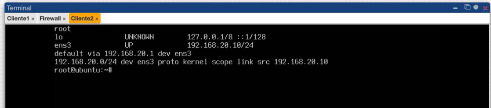

## Parte 3 - Bloqueio de ping com `sysctl`

```bash
sysctl -w net.ipv4.icmp_echo_ignore_all=1
tcpdump -i any -n icmp
```

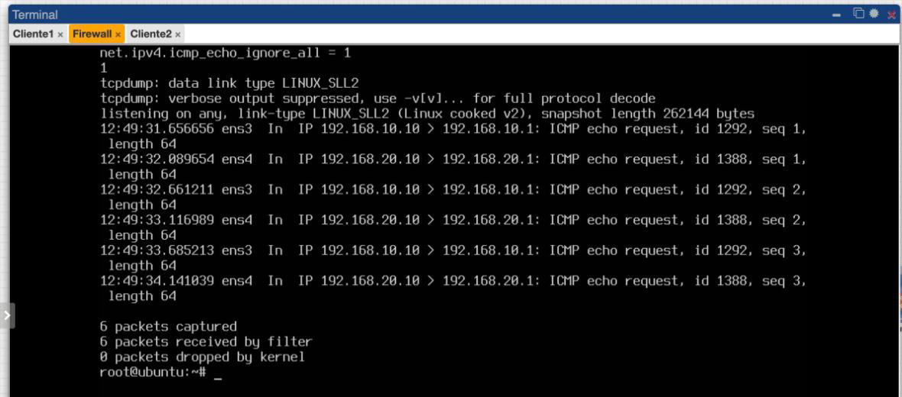

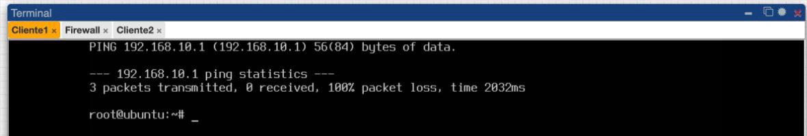

Com `icmp_echo_ignore_all=1`, o `tcpdump` mostra os *echo requests* chegando pelas duas interfaces, mas nenhum *echo reply* sai. Os clientes têm 100% de perda.

```bash
sysctl -w net.ipv4.icmp_echo_ignore_all=0
```

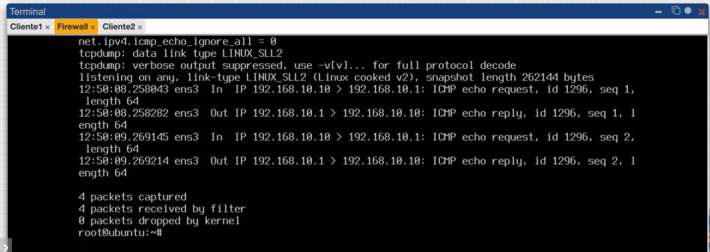

Ao reverter, cada *request* (`In`) passa a ter um *reply* (`Out`) logo em seguida. A diferença é que o pacote sempre chega ao firewall, e o `sysctl` só decide se o kernel responde ou não.

## Parte 4 - Teste sem firewall

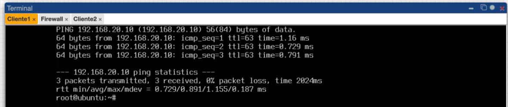

Antes das regras, Cliente1 alcança Cliente2 com TTL 63: o pacote atravessou o firewall, que está roteando.

## Parte 5 - Regras do iptables

```bash
iptables -F
iptables -X
iptables -Z
iptables -P FORWARD DROP
iptables -A FORWARD -s 192.168.10.10 -d 192.168.20.10 -p icmp -j ACCEPT
iptables -A FORWARD -s 192.168.20.10 -d 192.168.10.10 -p icmp -j ACCEPT
iptables -A FORWARD -s 192.168.10.10 -d 192.168.20.10 -p tcp --dport 80 -j ACCEPT
iptables -A FORWARD -s 192.168.20.10 -d 192.168.10.10 -p tcp --sport 80 -j ACCEPT
iptables -A FORWARD -s 192.168.10.10 -d 192.168.20.10 -p tcp --dport 23 -j DROP
```

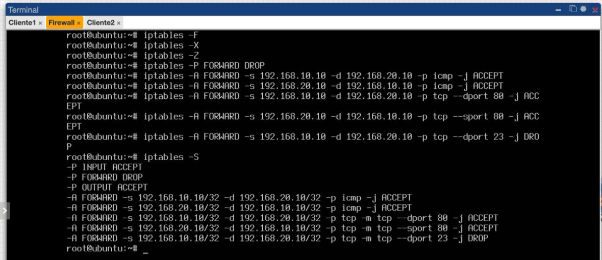

| # | Regra | Efeito |
| --- | --- | --- |
| Política | `FORWARD DROP` | Descarta tudo o que não for permitido |
| 1–2 | ICMP entre os dois clientes | Ping nos dois sentidos |
| 3 | TCP dport 80, Cliente1 → Cliente2 | Requisição HTTP |
| 4 | TCP sport 80, Cliente2 → Cliente1 | Resposta HTTP (retorno explícito) |
| 5 | TCP dport 23 → DROP | Telnet bloqueado explicitamente |

## Parte 6 - Testes

**Ping permitido**

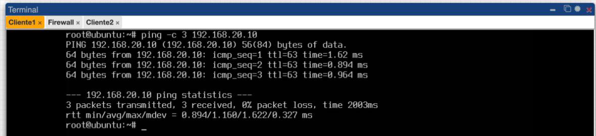

**HTTP permitido e Telnet bloqueado.** O Cliente2 rodou `python3 -m http.server 80`.

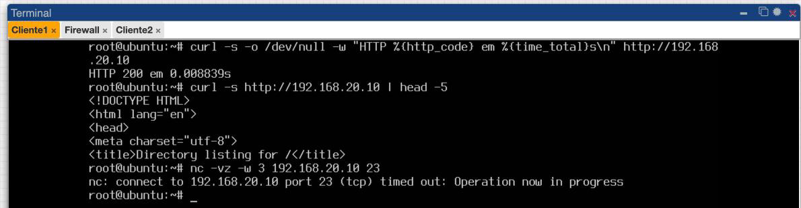

O `curl` retorna `HTTP 200` e a listagem de diretório. O Telnet termina em *timeout*: como o firewall descarta o pacote sem responder, o cliente não recebe nem um RST.

**Conexão iniciada pelo Cliente2**

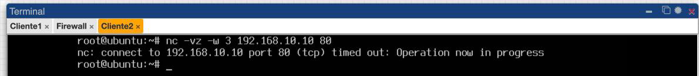

Bloqueada. Nenhuma regra permite TCP do Cliente2 para o Cliente1 com destino à porta 80, e o pacote cai na política `DROP`.

**Contadores**

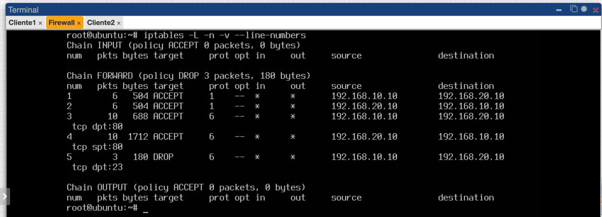

| Regra | Pacotes | Origem |
| --- | --- | --- |
| 1 e 2 (ICMP) | 6 e 6 | 3 pings em cada sentido, mais as respostas |
| 3 (HTTP ida) | 10 | 2 conexões `curl` |
| 4 (HTTP volta) | 10 | respostas do servidor |
| 5 (Telnet DROP) | 3 | SYN e retransmissões do `nc` para a porta 23 |
| Política DROP | 3 | SYNs do Cliente2 para a porta 80 do Cliente1 |

## Parte 7 - Questões para análise

**1. O que caracteriza um firewall de pacotes sem estado?**
Ele avalia cada pacote isoladamente, só pelos campos do cabeçalho, sem memória de conexões anteriores. Por isso o tráfego de retorno precisa de regras próprias.

**2. Quais campos do pacote foram usados nas regras?**
IP de origem (`-s`), IP de destino (`-d`), protocolo (`-p icmp`/`tcp`) e portas TCP de destino (`--dport`) e de origem (`--sport`).

**3. Por que foi necessário ativar o IP forwarding?**
Por padrão, o Linux descarta pacotes que não são destinados a ele próprio. Com `ip_forward=1` ele passa a rotear entre `ens3` e `ens4`, e esse tráfego atravessa a cadeia `FORWARD`.

**4. Qual é a função da cadeia `FORWARD`?**
Filtrar os pacotes que atravessam o firewall de uma interface para outra, ou seja, o tráfego entre as duas redes. `INPUT` e `OUTPUT` tratam o tráfego destinado ao próprio firewall ou originado nele.

**5. Por que o tráfego não permitido foi bloqueado mesmo sem regras específicas?**
Pela política padrão `FORWARD DROP`: o pacote que não casa com nenhuma regra recebe a ação da política. Foi o que aconteceu com o teste do Cliente2 para a porta 80 (3 pacotes no contador da política).

**6. Qual a diferença entre permitir HTTP e permitir ICMP?**
O ICMP não tem portas: basta liberar o protocolo entre os IPs. O HTTP roda sobre TCP e exige regra por porta. No modo stateless, são duas regras: a ida (`--dport 80`) e a volta (`--sport 80`).

**7. O que muda quando a política padrão da cadeia `FORWARD` é `DROP`?**
O firewall passa a funcionar como lista de permissões: só passa o que tem regra `ACCEPT`. Com `ACCEPT` como política, tudo passaria e seria preciso listar cada bloqueio.

**8. Por que esse laboratório ainda não é um firewall stateful?**
Porque nenhuma regra usa estado de conexão (`-m conntrack --ctstate ESTABLISHED,RELATED`). A regra de retorno `--sport 80` aceita qualquer pacote do Cliente2 com porta de origem 80, mesmo que não pertença a uma conexão aberta pelo Cliente1.

**9. Qual a importância da ordem das regras?**
O `iptables` avalia as regras de cima para baixo e para na primeira que casa. Uma regra `DROP` ampla antes de um `ACCEPT` específico anularia a permissão, e vice-versa.

**10. Quais vantagens surgem ao usar hosts Linux no lugar de VPCs?**
Disponibilidade de ferramentas reais: `python3 -m http.server`, `curl`, `nc` e `tcpdump`. Com elas é possível testar serviços TCP de verdade, e não apenas ping.

**11. Qual a diferença entre bloquear o ping com `sysctl` e bloquear ICMP com `iptables`?**
O `icmp_echo_ignore_all` só faz o kernel do firewall não responder aos pings destinados a ele. O pacote chega (visível no `tcpdump`, P5) e o ICMP encaminhado entre as redes não é afetado. O `iptables` filtra qualquer ICMP, em qualquer cadeia, e de forma seletiva por origem, destino e tipo.

## Conclusão

O firewall permitiu apenas ICMP entre os clientes e HTTP do Cliente1 para o Cliente2. Bloqueou o Telnet (regra explícita) e as conexões iniciadas pelo Cliente2 (política `DROP`), como mostram os testes e os contadores. A regra de retorno `--sport 80` evidencia a limitação do modelo stateless, que será tratada com o firewall stateful no Laboratório 11.
