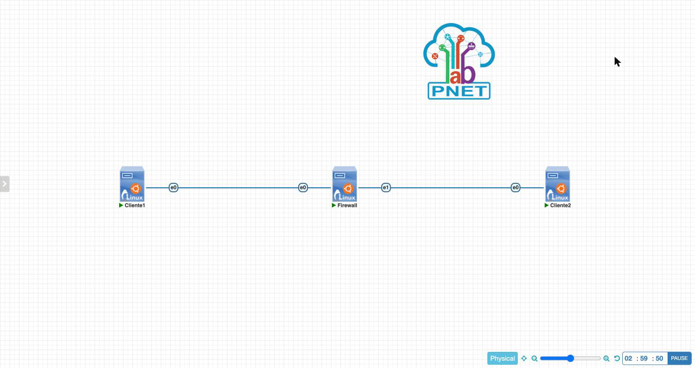
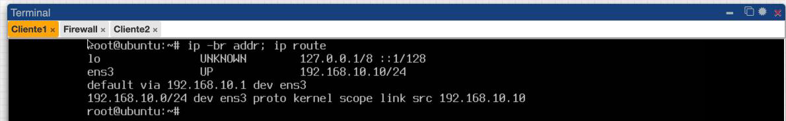
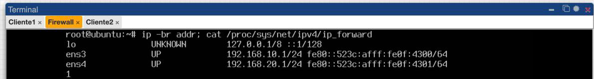
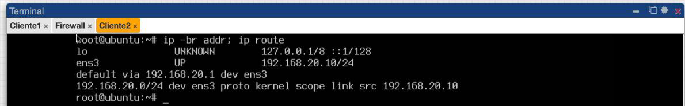
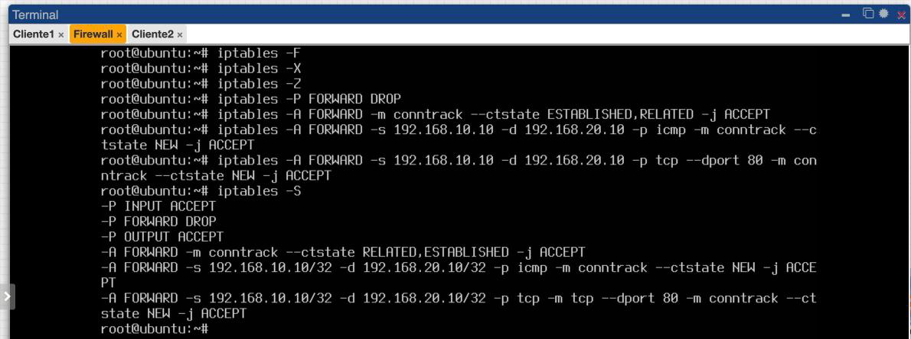
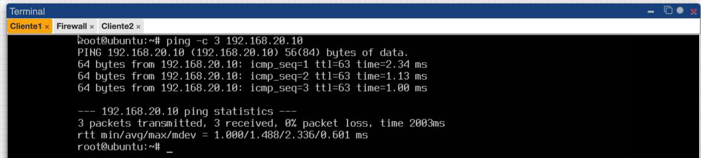
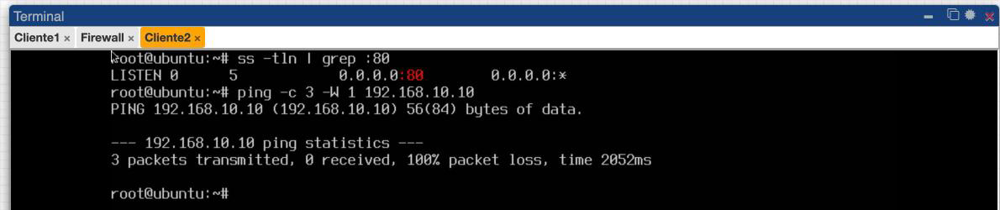
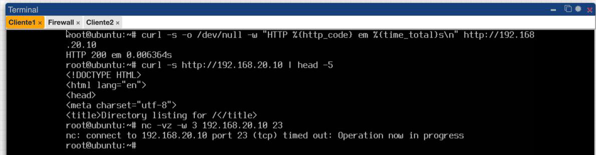
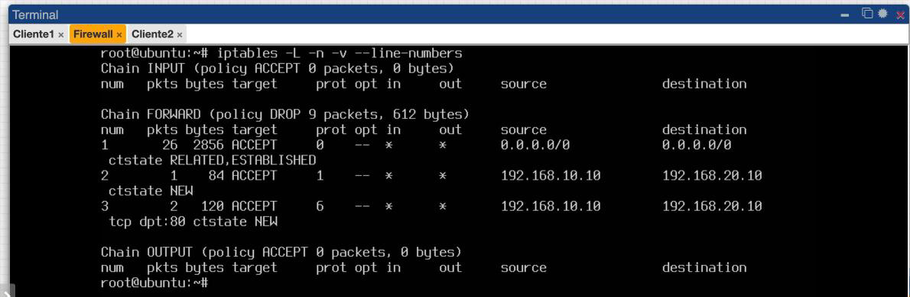

# Relatório 11 - Laboratório 11
**Arthur Choi Braga - 242014300**

Laboratório 11 - Firewall stateful
Disciplina ENE0025 - Protocolos de Transporte e Roteamento

## Objetivo

Substituir as regras *stateless* do Laboratório 10 por um firewall **stateful** com `iptables` e `conntrack`, permitindo apenas conexões iniciadas pelo Cliente1 e liberando o retorno automaticamente.

## Parte 1 - Topologia



A topologia e o endereçamento são os mesmos do Laboratório 10.

| Dispositivo | Interface | Endereço IP | Gateway |
| --- | --- | --- | --- |
| Cliente1 | ens3 | 192.168.10.10/24 | 192.168.10.1 |
| Firewall | ens3 / ens4 | 192.168.10.1/24 / 192.168.20.1/24 | — |
| Cliente2 | ens3 | 192.168.20.10/24 | 192.168.20.1 |

## Parte 2 - Configuração IP







## Parte 3 - Regras stateful

```bash
iptables -F
iptables -X
iptables -Z
iptables -P FORWARD DROP
iptables -A FORWARD -m conntrack --ctstate ESTABLISHED,RELATED -j ACCEPT
iptables -A FORWARD -s 192.168.10.10 -d 192.168.20.10 -p icmp -m conntrack --ctstate NEW -j ACCEPT
iptables -A FORWARD -s 192.168.10.10 -d 192.168.20.10 -p tcp --dport 80 -m conntrack --ctstate NEW -j ACCEPT
```



## Parte 4 - Testes

**Ping iniciado pelo Cliente1:** funciona.



**Ping iniciado pelo Cliente2:** falha. O servidor HTTP do Cliente2 (`python3 -m http.server 80`) está em escuta.



**HTTP iniciado pelo Cliente1 (funciona) e Telnet (bloqueado)**



**Nova conexão TCP iniciada pelo Cliente2:** bloqueada.


**Contadores**



| Regra | Pacotes | Leitura |
| --- | --- | --- |
| 1 `ESTABLISHED,RELATED` | 26 | todo o restante das sessões permitidas, nos dois sentidos |
| 2 ICMP `NEW` | 1 | só o primeiro *echo request* abriu a "conexão"; os demais e as respostas passaram pela regra 1 |
| 3 HTTP `NEW` | 2 | um SYN por `curl` |
| Política DROP | 9 | 3 pings do Cliente2, SYNs do Telnet e SYNs do Cliente2 para a porta 80 |

O utilitário `conntrack` não estava instalado na imagem do firewall (sem acesso à Internet para instalar). A análise foi feita pelos contadores, como prevê o roteiro.

## Parte 5 - Tabela comparativa

| Teste | Lab 10 - Stateless | Lab 11 - Stateful |
| --- | --- | --- |
| Ping iniciado pelo Cliente1 | Funciona | Funciona |
| Retorno da comunicação | Exige regra explícita de volta | Automático (`ESTABLISHED,RELATED`) |
| Ping iniciado pelo Cliente2 | Funciona (ICMP liberado nos dois sentidos) | Bloqueado |
| HTTP Cliente1 → Cliente2 | Funciona (regras `--dport 80` e `--sport 80`) | Funciona (uma regra `NEW`) |
| Nova conexão iniciada pelo Cliente2 | Bloqueada | Bloqueada |
| Telnet | Bloqueado (regra DROP explícita) | Bloqueado (política padrão) |
| Quantidade de regras | 5 | 3 |
| Facilidade de administração | Menor: cada serviço exige ida e volta | Maior: uma regra por serviço, retorno genérico |

**Diferença entre os modelos.** O filtro de pacotes avalia cada pacote isoladamente e não sabe se ele é a resposta de algo autorizado. Por isso exige regras de volta, que abrem brechas (qualquer pacote com porta de origem 80 passa). O stateful mantém uma tabela de conexões: só o primeiro pacote (`NEW`) é avaliado pelas regras de serviço, e os seguintes são aceitos por pertencerem a uma conexão conhecida.

## Parte 6 - Questões para análise

**1. O que diferencia um firewall stateful de um firewall de pacotes simples?**

O stateful acompanha o estado de cada conexão na tabela `conntrack` e decide com base nesse contexto. O filtro simples olha apenas os campos do cabeçalho de cada pacote isolado.

**2. Qual a função de `-m conntrack --ctstate ESTABLISHED,RELATED`?**

Aceitar pacotes de conexões já aceitas anteriormente (`ESTABLISHED`) e pacotes associados a elas, como mensagens ICMP de erro (`RELATED`).

**3. Por que o retorno HTTP não precisou de regra explícita?**

O SYN do Cliente1 foi aceito como `NEW` e criou a entrada na tabela. As respostas do Cliente2 pertencem a essa conexão e casam com a regra 1.

**4. O que caracteriza um pacote no estado `NEW`?**

É o primeiro pacote de um fluxo que ainda não tem entrada na tabela de conexões. No TCP, normalmente o SYN; no ICMP, o primeiro *echo request*.

**5. Qual a principal vantagem em relação ao Laboratório 10?**

Segurança e simplicidade. O retorno é aceito somente se pertencer a uma conexão aberta de dentro, eliminando a brecha da regra `--sport 80`, e a política fica com menos regras.

**6. Por que o Cliente2 não conseguiu iniciar conexões para o Cliente1?**

Os pacotes iniciais do Cliente2 são `NEW` e não há regra `NEW` com origem no Cliente2. Eles caem na política `DROP`, como mostra o contador (9 pacotes).

**7. O que mudou na quantidade e na lógica das regras?**

De 5 regras (ida e volta por serviço, mais o DROP do Telnet) para 3: uma regra genérica de retorno e uma regra `NEW` por serviço permitido. A lógica passou de "o pacote parece válido?" para "a conexão foi autorizada?".

**8. Em que tipo de ambiente um firewall stateful é mais adequado?**

Em praticamente qualquer borda de rede corporativa ou doméstica, onde os usuários internos iniciam conexões para fora e o tráfego de entrada não solicitado deve ser bloqueado.

**9. O firewall stateful elimina a necessidade de política padrão de bloqueio?**

Não. A regra `ESTABLISHED,RELATED` só trata o retorno. É a política `DROP` que bloqueia todas as conexões novas não autorizadas; sem ela, qualquer `NEW` passaria.

**10. O que a atividade comparativa mostrou de forma mais clara?**

Que no stateless o ping do Cliente2 passava, porque o ICMP precisava ser liberado nos dois sentidos para o retorno funcionar. No stateful ele é bloqueado sem perder o ping do Cliente1. O controle passa a ser feito pelo sentido de quem inicia a conexão.

## Conclusão

Com três regras, o firewall stateful permitiu ICMP e HTTP apenas quando iniciados pelo Cliente1, liberou os retornos automaticamente e bloqueou tudo o que partiu do Cliente2. Os contadores mostram o mecanismo: as regras de serviço só veem o primeiro pacote de cada conexão, e todo o restante passa pela regra `ESTABLISHED,RELATED`.
