# Relatório 12 - Laboratório 12
**Arthur Choi Braga - 242014300**

Laboratório 12 - Web Application Firewall (WAF) com Nginx, ModSecurity e OWASP CRS
Disciplina ENE0025 - Protocolos de Transporte e Roteamento

## Objetivo

Publicar um servidor web interno por meio de um WAF (Nginx como proxy reverso, com ModSecurity e OWASP CRS), de modo que todo o acesso do cliente passe pela inspeção HTTP.

## Parte 1 - Topologia

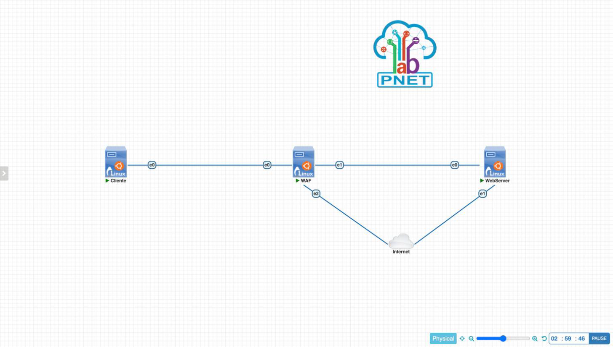

| Dispositivo | Interface | Endereço IP | Gateway |
| --- | --- | --- | --- |
| Cliente | ens3 | 192.168.10.10/24 | 192.168.10.1 |
| WAF | ens3 | 192.168.10.1/24 | — |
| WAF | ens4 | 192.168.20.1/24 | — |
| WebServer | ens3 | 192.168.20.10/24 | 192.168.20.1 |

O WAF e o WebServer também foram ligados à rede `nat0` do PNetLab (nuvem "Internet"), usada apenas para instalar os pacotes.

**Fluxo:** o Cliente abre uma conexão HTTP com o WAF (`192.168.10.1:80`). O Nginx encerra essa conexão, o ModSecurity inspeciona a requisição com as regras do CRS e, se ela for aprovada, o Nginx abre uma nova conexão com o backend (`192.168.20.10:80`) e devolve a resposta ao cliente.

## Parte 2 - Configuração IP

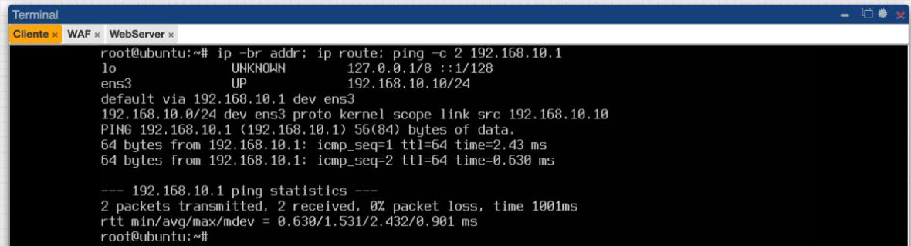

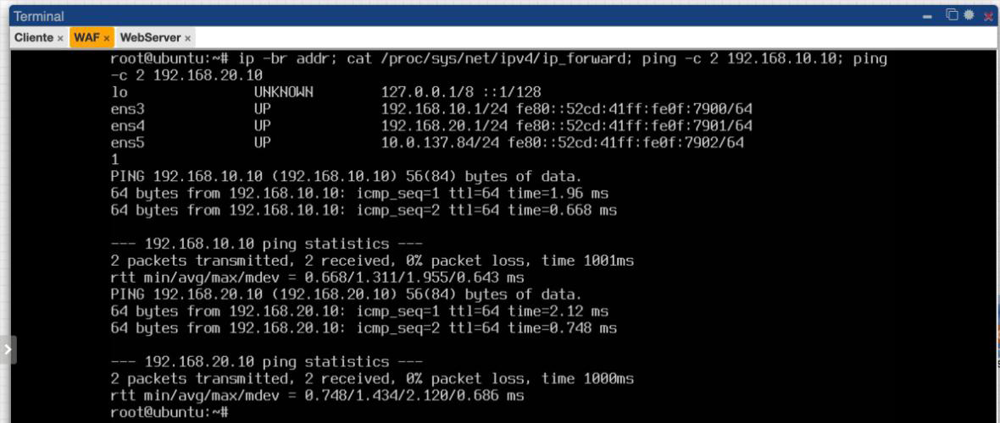

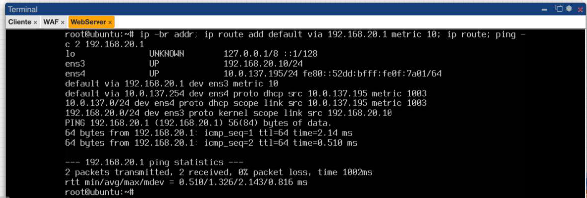

## Parte 3 - Servidor web interno

```bash
apt install -y nginx
echo "<h1>Servidor Web Interno OK</h1>" | tee /var/www/html/index.html
systemctl enable nginx
systemctl start nginx
curl http://127.0.0.1
```

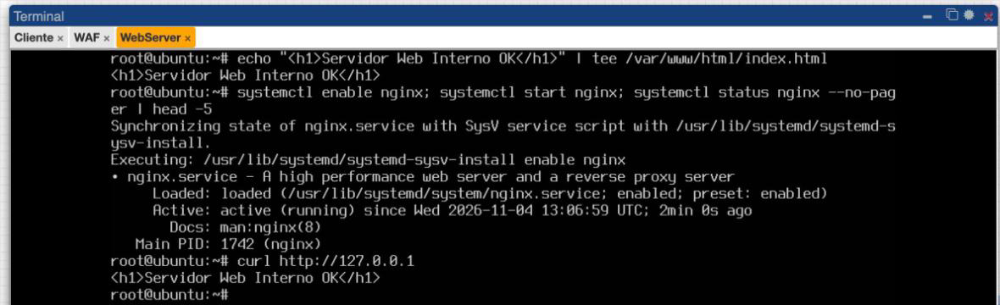

## Parte 4 - WAF

```bash
apt install -y nginx libnginx-mod-http-modsecurity modsecurity-crs
cp /usr/share/nginx/docs/modsecurity/modsecurity.conf /etc/modsecurity/modsecurity.conf
cp /usr/share/nginx/docs/modsecurity/unicode.mapping /etc/modsecurity/
sed -i 's/SecRuleEngine DetectionOnly/SecRuleEngine On/' /etc/modsecurity/modsecurity.conf
```

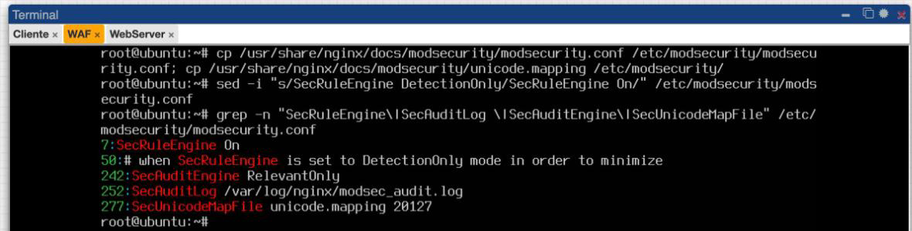

`/etc/nginx/modsec/main.conf` e `/etc/nginx/sites-available/default`:

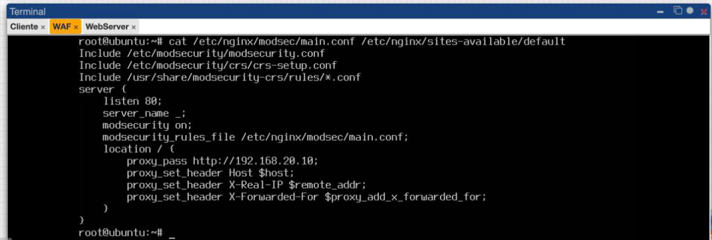

```bash
nginx -t
systemctl restart nginx
```

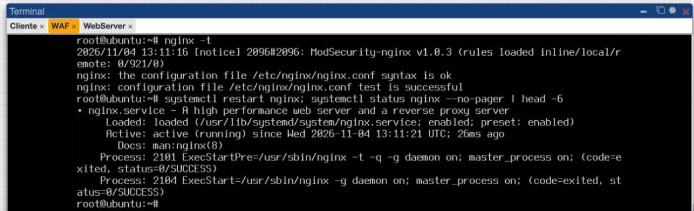

A configuração é válida, e o módulo informa `rules loaded inline/local/remote: 0/921/0`: as 921 regras do CRS 3.3.5 foram carregadas.

## Parte 5 - Testes

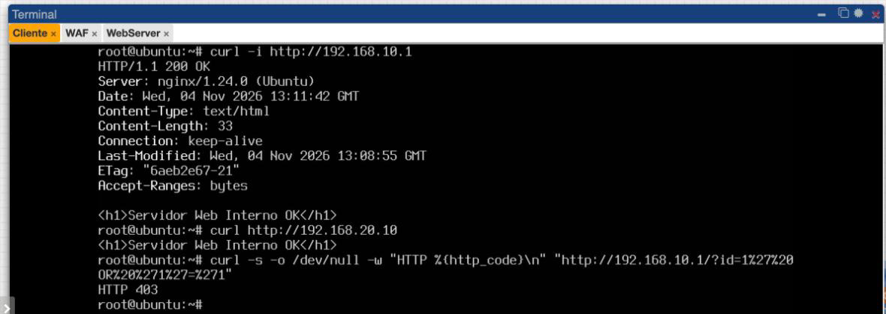

| Teste | Resultado |
| --- | --- |
| `curl -i http://192.168.10.1` (via WAF) | `200 OK`, página do servidor interno |
| `curl http://192.168.20.10` (direto) | funciona: com `ip_forward=1`, o cliente contorna o WAF |
| `curl "http://192.168.10.1/?id=1' OR '1'='1"` | `403 Forbidden`, bloqueado pelo ModSecurity |

## Parte 6 - Logs

**Nginx do WAF (`access.log` e `error.log`)**

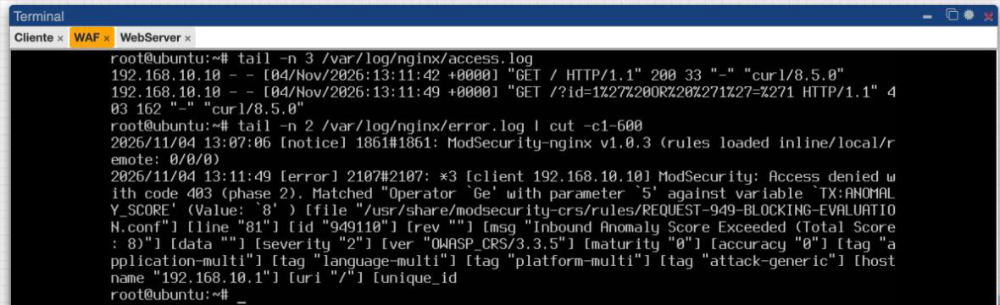

O `access.log` registra o `200` e o `403`. O `error.log` traz o motivo do bloqueio: regra 949110, *Inbound Anomaly Score Exceeded (Total Score: 8)*.

**ModSecurity (`/var/log/nginx/modsec_audit.log`)**

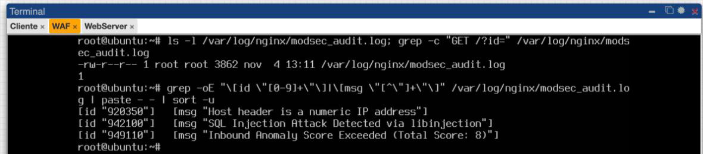

Regras disparadas pela requisição maliciosa: 942100 (*SQL Injection Attack Detected via libinjection*), 920350 (Host como IP numérico) e 949110 (soma da pontuação de anomalia acima do limite de 5, que gerou o bloqueio).

**Nginx do backend**

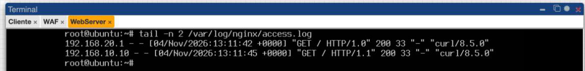

A requisição via WAF chega ao backend com origem `192.168.20.1` (o próprio WAF, em HTTP/1.0 do proxy). O acesso direto aparece com origem `192.168.10.10`. A requisição bloqueada não chegou ao backend.

## Parte 7 - Diferença entre firewall tradicional, stateful e WAF

| | Lab 10 - Stateless | Lab 11 - Stateful | Lab 12 - WAF |
| --- | --- | --- | --- |
| Camada | 3/4 | 3/4 + estado | 7 (HTTP) |
| Decide por | IP, protocolo, porta | o mesmo + estado da conexão | conteúdo da requisição (URI, parâmetros, cabeçalhos, corpo) |
| Papel do host | roteador com filtro | roteador com filtro | proxy reverso: encerra e recria a conexão |
| Porta 80 liberada | passa qualquer coisa na porta | passa qualquer coisa na porta | passa só requisições aprovadas pelas regras |

## Parte 8 - Questões para análise

**1. O que caracteriza um WAF?**

É um firewall de aplicação que entende o protocolo HTTP e inspeciona o conteúdo das requisições (e, opcionalmente, das respostas) para bloquear ataques como SQL injection, XSS e path traversal.

**2. Qual é a principal diferença entre um WAF e um firewall stateful?**

O stateful decide por IP, porta e estado da conexão, sem olhar a carga útil. O WAF analisa o conteúdo HTTP: no teste, as duas requisições foram para a mesma porta 80, mas só a que continha SQLi foi bloqueada.

**3. Por que o WAF é mais adequado para proteger aplicações web do que um firewall tradicional?**

Porque os ataques web usam o mesmo canal do tráfego legítimo (TCP/80 ou 443). Um firewall de rede precisa deixar essa porta aberta, e só a inspeção da camada de aplicação consegue distinguir uma requisição normal de uma maliciosa.

**4. Qual é a função do ModSecurity?**

É o motor de inspeção: integrado ao Nginx pelo módulo `libnginx-mod-http-modsecurity`, avalia cada requisição contra as regras carregadas e executa a ação (registrar, bloquear com 403).

**5. Qual é a função do OWASP CRS?**

Fornecer o conjunto genérico de regras de detecção (921 carregadas), com pontuação de anomalia. Cada regra que casa soma pontos, e a regra 949110 bloqueia quando o total passa do limite.

**6. O que significa operar o WAF como proxy reverso?**

O cliente conversa só com o WAF. O Nginx termina a conexão do cliente, inspeciona a requisição e abre outra conexão com o backend, em nome do cliente. Por isso o backend vê o acesso vindo de `192.168.20.1` no log do backend.

**7. Por que o acesso ao backend deve ocorrer preferencialmente por meio do WAF?**

Porque o acesso direto contorna a inspeção. O teste mostrou que, com `ip_forward=1`, o cliente acessa `192.168.20.10` diretamente, e um ataque por esse caminho não seria analisado. O backend deve aceitar HTTP apenas do WAF, e o encaminhamento IP deve ser desabilitado.

**8. Que vantagens surgem ao separar cliente, WAF e servidor em redes distintas?**

O WAF vira o único ponto de passagem entre as redes, o que facilita impor que todo acesso seja inspecionado. O backend fica sem exposição direta, e falhas ou ataques ficam isolados por segmento.

**9. O WAF substitui o firewall de rede?**

Não. O WAF só trata HTTP. Continua sendo necessário um firewall de rede para bloquear outras portas e protocolos, impedir o *bypass* direto ao backend (como visto no teste) e proteger o próprio WAF.

**10. Qual a principal evolução conceitual entre os Labs 10, 11 e 12?**

A profundidade da inspeção. O Lab 10 olha cada pacote isolado (camadas 3/4), o Lab 11 acrescenta o estado da conexão, e o Lab 12 passa a entender o conteúdo da aplicação (camada 7). As camadas são complementares.

## Conclusão

O WAF publicou o servidor interno no IP `192.168.10.1`: requisições legítimas receberam `200`, e uma requisição com SQL injection na mesma porta 80 foi bloqueada com `403` pelo CRS, com o registro completo nos logs do Nginx e do ModSecurity, sem chegar ao backend. O teste de acesso direto mostrou que a proteção só é efetiva se o backend for alcançável exclusivamente pelo WAF.
