# Relatório 4 - Laboratório 4
**Arthur Choi Braga - 242014300**

Laboratório 04 - RIP e análise de convergência
Disciplina ENE0025 - Protocolos de Transporte e Roteamento

## Parte 1 - Setup da topologia

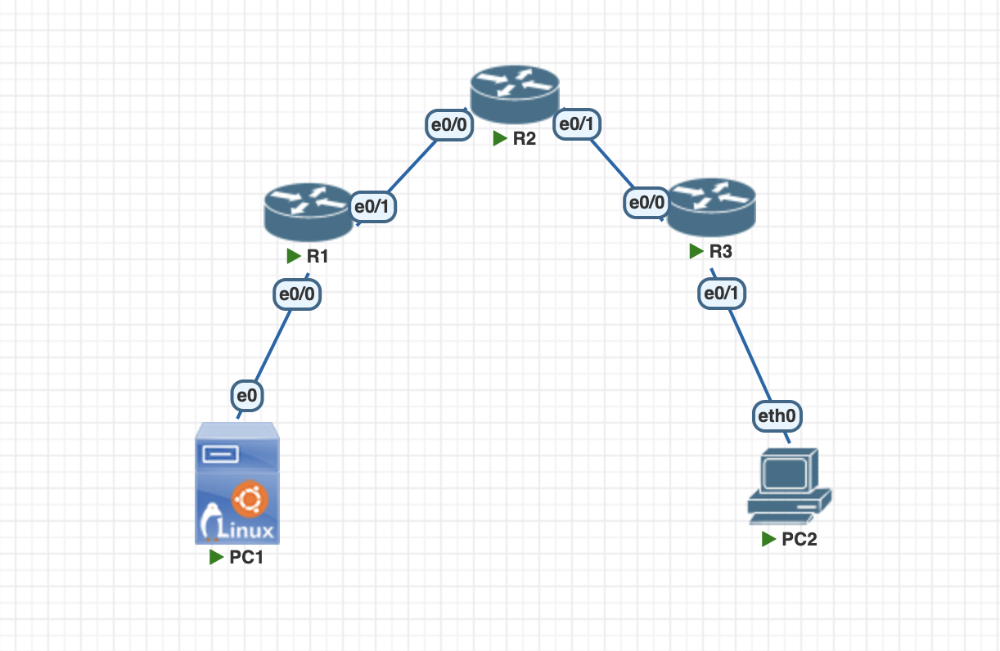

A topologia foi montada no PNetLab com 3 roteadores (imagem IOL L3, interfaces `Ethernet0/0` em diante), 1 host Linux (Ubuntu) como PC1 e 1 host VPCS como PC2, formando uma cadeia linear com duas LANs nas pontas e dois enlaces ponto a ponto `/30` no núcleo. As conexões foram:

- PC1 `e0` → R1 `Ethernet0/0`
- R1 `Ethernet0/1` → R2 `Ethernet0/0`
- R2 `Ethernet0/1` → R3 `Ethernet0/0`
- R3 `Ethernet0/1` → PC2 `eth0`

Duas adaptações em relação ao roteiro:

- as interfaces do roteador não são `g0/0` e `g0/1`, e sim `Ethernet0/0` e `Ethernet0/1`, nomenclatura da imagem IOL — a mesma adaptação já registrada nos Laboratórios 2 e 3;
- o PC1 foi implementado como host Ubuntu em vez de VPCS, o que permitiu usar os comandos `ip` do Linux e o `ping` com contagem de pacotes e estatísticas de RTT. O PC2 permaneceu como VPCS, conforme o roteiro.

## Parte 2 - Endereçamento IP

O endereçamento utilizado foi o proposto no roteiro:

| Dispositivo | Interface | Endereço IP   | Máscara         | Gateway      | Observação                  |
| ----------- | --------- | ------------- | --------------- | ------------ | --------------------------- |
| R1          | Et0/0     | 192.168.10.1  | 255.255.255.0   | —            | LAN 1 (PC1)                 |
| R1          | Et0/1     | 10.0.12.1     | 255.255.255.252 | —            | Enlace R1–R2                |
| R2          | Et0/0     | 10.0.12.2     | 255.255.255.252 | —            | Enlace R1–R2                |
| R2          | Et0/1     | 10.0.23.1     | 255.255.255.252 | —            | Enlace R2–R3 (será derrubado) |
| R3          | Et0/0     | 10.0.23.2     | 255.255.255.252 | —            | Enlace R2–R3                |
| R3          | Et0/1     | 192.168.30.1  | 255.255.255.0   | —            | LAN 3 (PC2)                 |
| PC1         | eth0      | 192.168.10.10 | 255.255.255.0   | 192.168.10.1 | Host Ubuntu                 |
| PC2         | eth0      | 192.168.30.10 | 255.255.255.0   | 192.168.30.1 | Host VPC                 |

## Parte 3 - Configuração dos roteadores

### 1. R1

```bash
enable
configure terminal
hostname R1
no ip domain-lookup
service timestamps debug datetime msec
service timestamps log datetime msec

interface Ethernet0/0
 description LAN1-PC1
 ip address 192.168.10.1 255.255.255.0
 no shutdown
 exit

interface Ethernet0/1
 description LINK-R2
 ip address 10.0.12.1 255.255.255.252
 no shutdown
 exit

router rip
 version 2
 no auto-summary
 network 192.168.10.0
 network 10.0.12.0
 exit
end
copy running-config startup-config
```

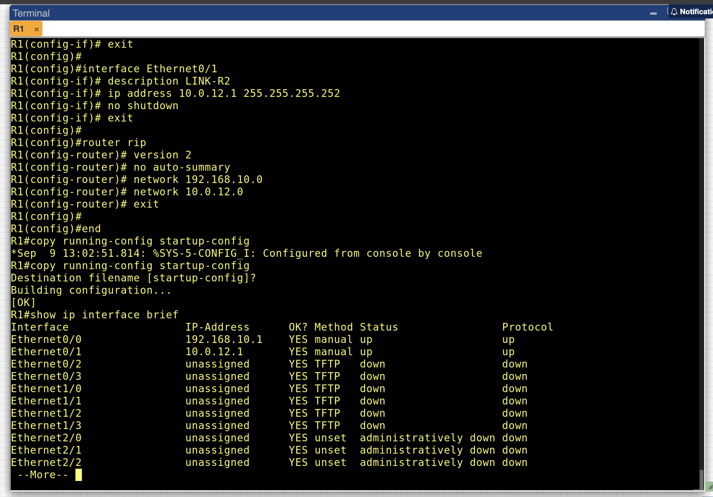

O `show ip interface brief` confirma `Ethernet0/0` com `192.168.10.1` e `Ethernet0/1` com `10.0.12.1`, ambas `up/up`. As demais interfaces do IOL permanecem `unassigned` e `down`, sem uso nesta topologia.

### 2. R2

```bash
enable
configure terminal
hostname R2
no ip domain-lookup
service timestamps debug datetime msec
service timestamps log datetime msec

interface Ethernet0/0
 description LINK-R1
 ip address 10.0.12.2 255.255.255.252
 no shutdown
 exit

interface Ethernet0/1
 description LINK-R3
 ip address 10.0.23.1 255.255.255.252
 no shutdown
 exit

router rip
 version 2
 no auto-summary
 network 10.0.12.0
 network 10.0.23.0
 exit
end
copy running-config startup-config
```

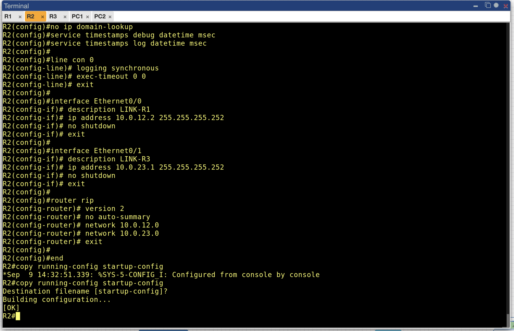

O R2 é o único roteador sem LAN de usuário: suas duas interfaces são enlaces `/30` de trânsito. Ele funciona como o nó intermediário que repassa informações de roteamento entre as duas pontas, e é justamente por isso que a falha simulada na Parte 6 foi aplicada nele.

### 3. R3

```bash
enable
configure terminal
hostname R3
no ip domain-lookup
service timestamps debug datetime msec
service timestamps log datetime msec

interface Ethernet0/0
 description LINK-R2
 ip address 10.0.23.2 255.255.255.252
 no shutdown
 exit

interface Ethernet0/1
 description LAN3-VPC2
 ip address 192.168.30.1 255.255.255.0
 no shutdown
 exit

router rip
 version 2
 no auto-summary
 network 10.0.23.0
 network 192.168.30.0
 exit
end
copy running-config startup-config
```

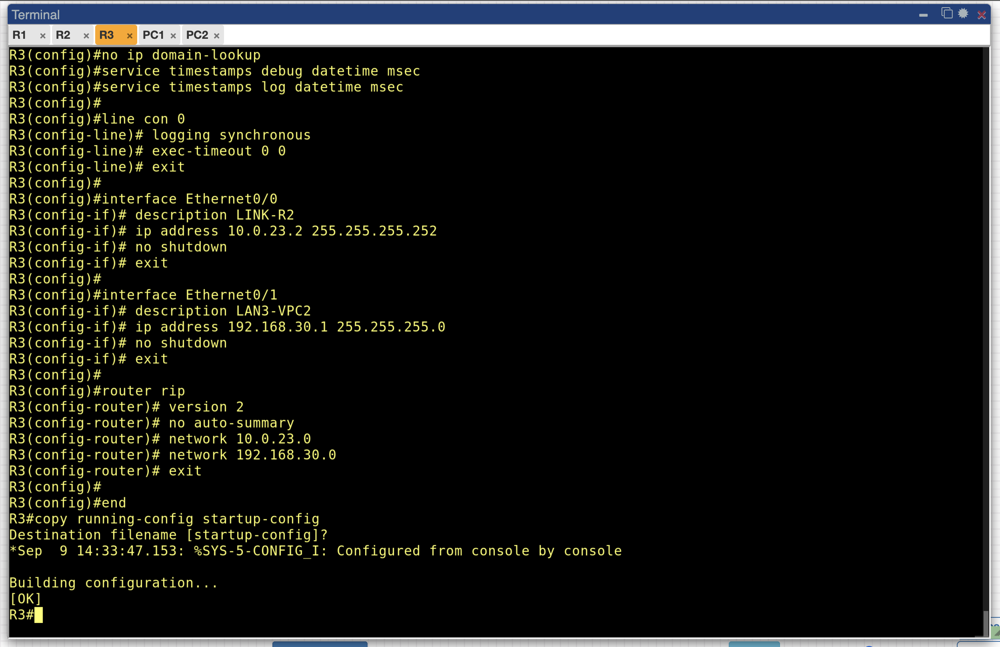


## Parte 4 - Configuração dos hosts

**PC1 (Ubuntu):**

```bash
sudo ip addr add 192.168.10.10/24 dev eth0
sudo ip link set eth0 up
sudo ip route add default via 192.168.10.1
```

**PC2 (VPCS):**

```
ip 192.168.30.10/24 192.168.30.1
save
```


## Parte 5 - Verificação do estado estável

### 1. Parâmetros do protocolo no R2

```bash
show ip protocols
```

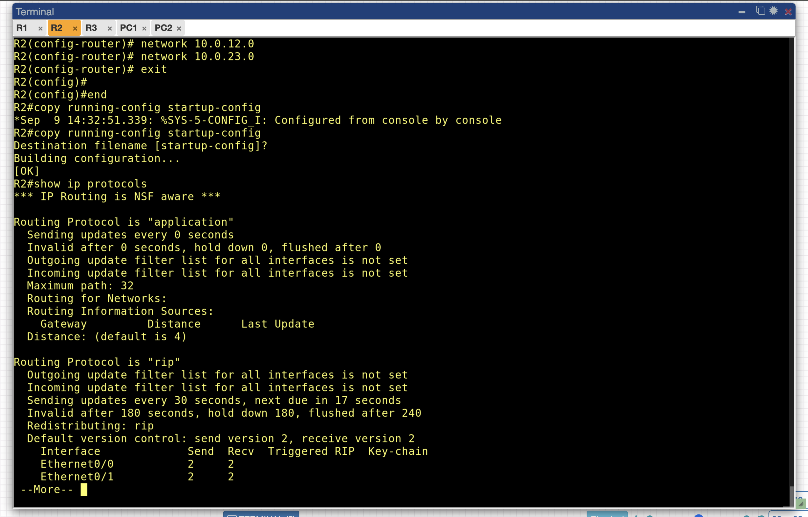

Esta saída fornece os números que sustentam toda a análise da Parte 6:

| Temporizador | Valor | Função |
| --- | --- | --- |
| Update | 30 s | intervalo entre anúncios periódicos |
| Invalid | 180 s | tempo sem atualização até a rota ser considerada suspeita |
| Holddown | 180 s | período em que o roteador rejeita informações piores sobre a rota |
| Flush | 240 s | tempo até a remoção definitiva da rota |

A saída confirma ainda que o controle de versão está em `send version 2, receive version 2` nas duas interfaces, ou seja, o RIPv2 está ativo em ambos os sentidos, e que não há filtros de entrada ou saída configurados.

### 2. Tabela de roteamento do R1

```bash
show ip route
show ip route rip
show ip rip database
```

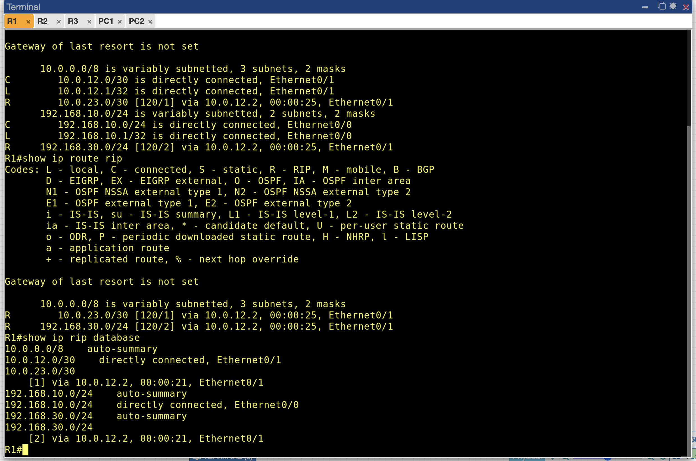

A tabela do R1 contém quatro entradas relevantes:

```
C    10.0.12.0/30     is directly connected, Ethernet0/1
R    10.0.23.0/30     [120/1] via 10.0.12.2, 00:00:25, Ethernet0/1
C    192.168.10.0/24  is directly connected, Ethernet0/0
R    192.168.30.0/24  [120/2] via 10.0.12.2, 00:00:25, Ethernet0/1
```

O `show ip rip database` mostra a mesma informação sob a ótica do protocolo, listando as redes classful como agrupadores e, abaixo de cada uma, as sub-redes reais com sua métrica entre colchetes e o vizinho que as anunciou.

### 3. Tabela de roteamento do R3

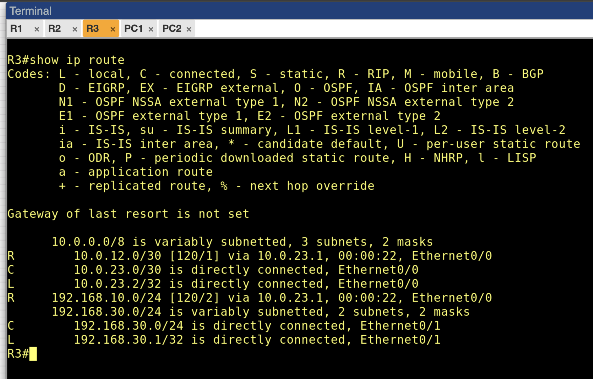

O R3 apresenta a imagem especular do R1:

```
R    10.0.12.0/30     [120/1] via 10.0.23.1, 00:00:22, Ethernet0/0
C    10.0.23.0/30     is directly connected, Ethernet0/0
R    192.168.10.0/24  [120/2] via 10.0.23.1, 00:00:22, Ethernet0/0
C    192.168.30.0/24  is directly connected, Ethernet0/1
```

A simetria entre as duas tabelas é a evidência de que a rede convergiu: cada extremidade conhece a rede da outra com métrica 2, e ambas apontam para o R2 como próximo salto. Note que essas quatro linhas do R3 foram aprendidas **sem nenhuma configuração de rota estática** — é o resultado da troca automática de vetores-distância, e é a diferença fundamental em relação ao Laboratório 1, onde toda a informação de encaminhamento foi inserida manualmente.

### 4. Conectividade fim a fim

No PC1:

```bash
ping -c 4 192.168.10.1
ping -c 4 192.168.30.10
```

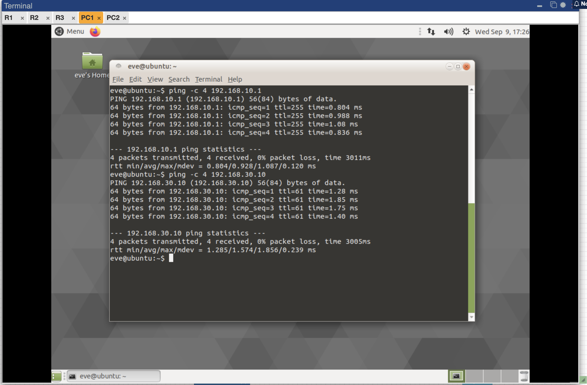

**Resultado:** sucesso nos dois casos, 0% de perda. RTT médio de 0,928 ms para o gateway local e 1,574 ms para o PC2.

### 5. Anúncios RIP em operação normal

```bash
debug ip rip
```

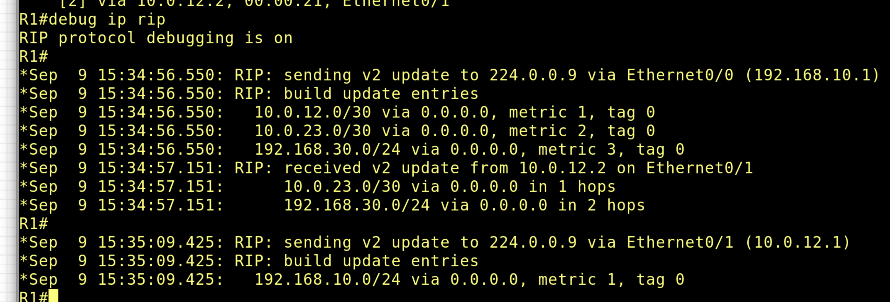

O debug com timestamps revela a mecânica do protocolo em funcionamento. Dois blocos merecem atenção especial, e o contraste entre eles é o ponto mais interessante desta seção.

**Anúncio enviado pela `Ethernet0/0` (para a LAN 1), às 15:34:56:**

```
10.0.12.0/30     metric 1
10.0.23.0/30     metric 2
192.168.30.0/24  metric 3
```

**Anúncio enviado pela `Ethernet0/1` (de volta para o R2), às 15:35:09:**

```
192.168.10.0/24  metric 1
```

O R1 anuncia **tudo o que conhece** pela interface da LAN, mas envia apenas a sua própria rede de volta para o R2. As rotas `10.0.23.0/30` e `192.168.30.0/24`, que foram aprendidas pelo R2, **não são reanunciadas para ele**. Isso é o **split horizon** operando: a regra que impede que uma rota aprendida por uma interface seja anunciada de volta pela mesma interface, evitando que dois roteadores fiquem se confirmando mutuamente uma informação que originalmente veio de um deles.

O bloco intermediário mostra o R1 **recebendo** de `10.0.12.2` as duas rotas com 1 e 2 saltos, confirmando o fluxo bidirecional de informação a cada ciclo de 30 segundos.

## Parte 6 - Experimento de convergência

### 1. A falha aplicada

No R2, com registro do horário antes da mudança:

```bash
show clock
configure terminal
interface Ethernet0/1
 shutdown
end
```

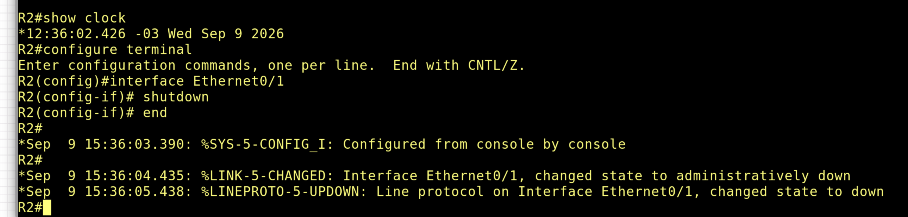

A saída registra a sequência com precisão de milissegundos:

| Horário | Evento |
| --- | --- |
| 15:36:03.390 | comando de configuração aplicado |
| **15:36:04.435** | `%LINK-5-CHANGED`: interface em `administratively down` |
| 15:36:05.438 | `%LINEPROTO-5-UPDOWN`: protocolo de linha em `down` |

O marco **15:36:04.435** é o instante zero de toda a medição a seguir.

Um detalhe de leitura: o `show clock` exibe `12:36:02 -03`, enquanto os logs mostram `15:36:03`. Não é inconsistência — o relógio do sistema está configurado no fuso local (UTC−3) e os logs são carimbados em UTC. Os dois se referem ao mesmo instante.

### 2. Reação do R1 — convergência por notificação

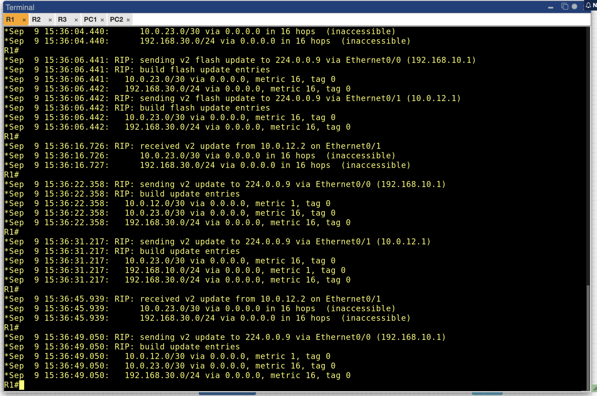

```
15:36:04.440:  10.0.23.0/30     via 0.0.0.0 in 16 hops  (inaccessible)
15:36:04.440:  192.168.30.0/24  via 0.0.0.0 in 16 hops  (inaccessible)
```

O R1 recebeu a notificação de rota morta às **15:36:04.440**, contra o `%LINK-5-CHANGED` do R2 às **15:36:04.435**. A diferença é de **5 milissegundos**. O R1 soube da falha praticamente no mesmo instante em que ela ocorreu, sem esperar nenhum dos temporizadores de 30, 180 ou 240 segundos.

Isso acontece pela combinação de dois mecanismos. O R2 detectou a queda da própria interface por sinalização local — não precisou inferir nada — e, ao invés de aguardar o próximo ciclo periódico, disparou um **triggered update** imediato. A informação transmitida não foi a omissão da rota, mas seu anúncio explícito com **métrica 16**, valor que o RIP trata como infinito. É o **route poisoning**: em vez de deixar o vizinho descobrir a ausência, avisa-se ativamente que o destino morreu.

A propagação continua nas linhas seguintes. Às 15:36:06.441, o próprio R1 gera um `flash update` repassando as duas rotas com métrica 16 para a LAN 1, dois segundos após ter recebido a notícia.

E aqui aparece o segundo achado interessante do experimento. Comparando com o estado estável da Parte 5.5:

| Anúncio do R1 pela `Ethernet0/1` (em direção ao R2) | Conteúdo |
| --- | --- |
| Estado estável (15:35:09) | apenas `192.168.10.0/24` metric 1 |
| Após a falha (15:36:31) | `192.168.10.0/24` metric 1, `10.0.23.0/30` metric 16, `192.168.30.0/24` metric 16 |

Em operação normal, o split horizon suprimia completamente as rotas aprendidas do R2 nos anúncios enviados de volta a ele. Após a falha, essas mesmas rotas **voltam a aparecer**, mas carregando métrica 16. Esse é o **poison reverse**: uma exceção deliberada ao split horizon, em que a rota volta a ser anunciada na direção de origem justamente para declarar que está inalcançável. 

### 3. Tabela do R1 após a convergência

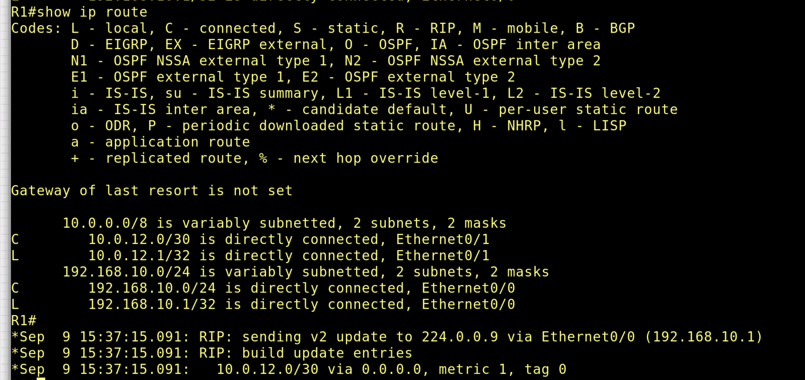

A tabela do R1 ficou reduzida às rotas diretamente conectadas:

```
C    10.0.12.0/30     is directly connected, Ethernet0/1
C    192.168.10.0/24  is directly connected, Ethernet0/0
```

Ambas as entradas `R` desapareceram. O R1 chegou a um estado consistente com a nova realidade da topologia, e o horário do debug logo abaixo (15:37:15) indica que a limpeza completa da tabela ocorreu em torno de um minuto após a falha — o intervalo entre a marcação da rota como inalcançável e sua remoção definitiva corresponde ao ciclo de holddown do protocolo.

### 4. Reação do R3 — convergência por temporizador

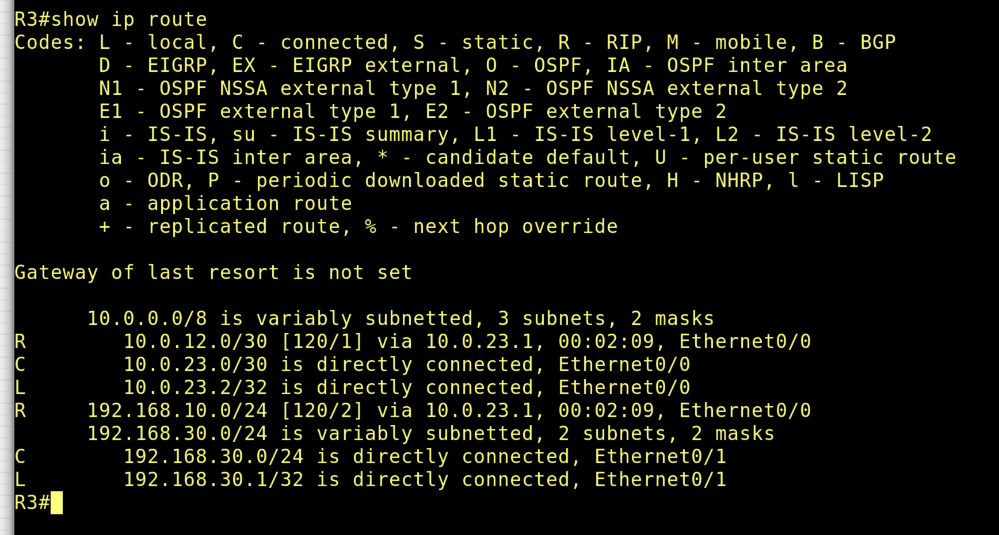

O contraste com o R1 é total. A tabela do R3 ainda contém as duas rotas aprendidas via R2:

```
R    10.0.12.0/30     [120/1] via 10.0.23.1, 00:02:09, Ethernet0/0
R    192.168.10.0/24  [120/2] via 10.0.23.1, 00:02:09, Ethernet0/0
```

O campo de idade marca **2 minutos e 9 segundos** desde o último anúncio recebido — e as rotas continuam ativas na tabela. Enquanto o R1 já estava completamente convergido, o R3 seguia acreditando em um caminho que não existia mais.

A explicação está na assimetria da informação disponível para cada roteador. Quando o `shutdown` foi aplicado, três coisas distintas aconteceram:

1. **o R2 soube por sinalização local** — a interface era dele, e o IOS remove imediatamente todas as rotas cuja interface de saída deixa de existir;
2. **o R1 foi avisado** — recebeu o triggered update com métrica 16 em 5 ms;
3. **o R3 não soube de nada.** No PNetLab, o enlace entre os roteadores é virtual, e o `shutdown` administrativo de um lado não propaga sinal de perda de portadora para o outro. A `Ethernet0/0` do R3 permaneceu `up/up`. Sem detecção física e sem nenhuma mensagem RIP informando a falha, restou ao R3 apenas o **silêncio** — e o silêncio só se torna conclusivo quando o temporizador de invalidação de **180 segundos** expira, com a remoção definitiva aos **240 segundos**.

Durante todo esse intervalo, o R3 continuou encaminhando para `10.0.23.1` qualquer pacote destinado à LAN 1 — um caminho que já não levava a lugar nenhum. Trata-se de um buraco negro silencioso: os pacotes são descartados sem que nenhuma mensagem de erro seja gerada, porque do ponto de vista do R3 a rota era válida. No sentido oposto, o R1 respondia explicitamente `Destination Host Unreachable`, por saber que não tinha rota. O mesmo enlace rompido produziu dois comportamentos completamente diferentes, dependendo apenas de o roteador ter sido informado ou não.

### 5. Síntese da medição

| Ponto de observação | Como soube da falha | Tempo até convergir |
| --- | --- | --- |
| R2 | detecção local da interface | imediato |
| R1 | triggered update com métrica 16 | ~5 ms para a notificação; ~1 min para limpar a tabela |
| R3 | ausência de anúncios (invalid timer) | ainda não convergido aos 2 min 09 s; previsto 180 s / 240 s |

## Parte 7 - Questões para análise

**1. Qual foi o tempo aproximado de convergência após a falha do enlace?**

A resposta depende do ponto de observação, e essa é a principal constatação do experimento. No **R1**, a convergência foi praticamente instantânea: o `%LINK-5-CHANGED` no R2 ocorreu às 15:36:04.435 e o R1 recebeu a notificação de métrica 16 às 15:36:04.440, uma diferença de **5 milissegundos**, com a tabela completamente limpa cerca de um minuto depois. No **R3**, ao contrário, as rotas ainda estavam presentes na tabela **2 minutos e 9 segundos** após a falha, aguardando a expiração do temporizador de invalidação de 180 segundos, com remoção definitiva prevista para 240 segundos.

**2. Quais rotas deixaram de aparecer na tabela de roteamento após a interrupção?**

No **R2**, as duas rotas associadas à interface derrubada: `10.0.23.0/30`, que era diretamente conectada, e `192.168.30.0/24`, que havia sido aprendida por aquela interface. No **R1**, as mesmas duas rotas, ambas do tipo `R` aprendidas via `10.0.12.2`, restando apenas as duas conectadas. No **R3**, as rotas `10.0.12.0/30` e `192.168.10.0/24` — mas apenas após o ciclo completo de temporizadores, e não no momento da falha.

**3. O que aconteceu com o tráfego entre as redes 192.168.10.0/24 e 192.168.30.0/24 após a falha?**

Os dois sentidos foram interrompidos, mas de maneiras qualitativamente diferentes. No sentido **PC1 → PC2**, o R1 removeu a rota em segundos e passou a responder com ICMP *Destination Host Unreachable* — falha explícita e imediata, com o emissor sendo informado do problema. No sentido **PC2 → PC1**, o R3 continuou por quase três minutos encaminhando pacotes para `10.0.23.1`, um próximo salto que já não conduzia a nada, sem gerar nenhuma mensagem de erro. Do ponto de vista da aplicação, o primeiro caso produz erro imediato e o segundo produz perda silenciosa com espera até o timeout — a distinção entre falha detectada e falha inferida por ausência de informação.

**4. Como o RIP representa uma rota inalcançável?**

Pela métrica **16**, tratada como infinito pelo protocolo, já que o RIP admite no máximo 15 saltos válidos. Essa representação permite ao roteador **anunciar ativamente** que uma rota morreu, em vez de simplesmente omiti-la dos anúncios seguintes — mecanismo conhecido como *route poisoning*. A vantagem é a rapidez: omitir uma rota exigiria que o vizinho esperasse o temporizador expirar para perceber a ausência, enquanto o anúncio explícito é processado no ato. O debug capturado registra isso literalmente, com as entradas marcadas `in 16 hops (inaccessible)` e propagadas em seguida como `metric 16, tag 0`.

**5. Por que o RIP tende a convergir mais lentamente do que protocolos como o OSPF?**

Porque os dois operam sobre modelos de informação diferentes. O RIP é vetor-distância: cada roteador conhece apenas o que os vizinhos lhe contam, sem qualquer visão da topologia. Quando existe notificação — como no caso do R1 — ele é rápido. Mas quando a notificação não chega, como no R3, a única evidência disponível é o silêncio, e o silêncio precisa durar 180 segundos para ser conclusivo. O protocolo não tem como distinguir um vizinho morto de um vizinho momentaneamente atrasado sem esperar esse intervalo.

O OSPF é estado de enlace: cada roteador mantém um mapa completo da área, detecta vizinhos inativos pelo *dead interval* (40 segundos por padrão, contra 180), inunda LSAs imediatamente por toda a área em vez de repassá-los salto a salto, e recalcula os caminhos pelo algoritmo de Dijkstra sobre a topologia inteira. Além disso, sua métrica é baseada em largura de banda, enquanto o RIP conta apenas saltos, ignorando a capacidade dos enlaces.

**6. Qual a importância dos mecanismos de split horizon, poison reverse e triggered updates?**

Os três atacam o problema de *count to infinity*, e os três foram observados diretamente neste laboratório.

O **split horizon** apareceu no debug em estado estável: o R1 anunciava todas as rotas conhecidas pela `Ethernet0/0`, mas enviava apenas a própria rede de volta pela `Ethernet0/1`. Ao não devolver ao R2 aquilo que veio dele, evita-se que os dois roteadores fiquem reforçando mutuamente uma informação obsoleta.

O **poison reverse** apareceu após a falha, na mesma interface: as rotas antes suprimidas voltaram a ser anunciadas na direção do R2, agora com métrica 16. É uma exceção deliberada ao split horizon — em vez do silêncio, envia-se uma negação explícita, que não pode ser mal interpretada.

Os **triggered updates** foram o que produziu a convergência em 5 milissegundos no R1. Sem eles, mesmo tendo o R2 detectado a falha instantaneamente, o R1 teria que aguardar o próximo ciclo periódico. O contraste com o R3, que não recebeu triggered update algum e teve que esperar 180 segundos, mede exatamente o valor prático desse mecanismo.

**7. Em que tipo de cenário real o RIP deixaria de ser uma escolha adequada?**

Em qualquer rede cujo diâmetro ultrapasse 15 saltos, por limitação estrutural do protocolo. Em redes que exigem convergência rápida — telefonia IP, videoconferência, sistemas transacionais, ambientes de alta disponibilidade —, onde uma janela de até três minutos com tráfego caindo em buraco negro é inaceitável. Em topologias com enlaces de capacidades diferentes, porque a métrica por saltos ignora largura de banda: um caminho de 10 Gbps com dois saltos seria preterido em favor de um de 2 Mbps com um salto. E em redes grandes, onde o anúncio periódico da tabela completa a cada 30 segundos por todas as interfaces se torna um custo relevante de processamento e banda.

O RIP permanece defensável em redes pequenas, estáveis, com topologia simples e sem requisitos rígidos de disponibilidade — e, como neste laboratório, como ferramenta didática, precisamente porque seus mecanismos são simples o bastante para serem observados um a um.

## Conclusão

O laboratório cumpriu o objetivo de configurar um protocolo de roteamento dinâmico em topologia com múltiplos roteadores e analisar o comportamento da rede diante de uma falha de enlace. Foi possível montar a cadeia de três roteadores com duas LANs e dois enlaces `/30`, habilitar o RIPv2 com `no auto-summary`, verificar a propagação automática das rotas nas duas extremidades, validar a conectividade fim a fim e medir com precisão de milissegundos o processo de convergência após a interrupção do enlace entre R2 e R3.


 No Laboratório 3, o PIM-DM já construía estado automaticamente, mas apoiado em uma tabela unicast formada apenas por rotas diretamente conectadas. Aqui, pela primeira vez, **a tabela de roteamento foi construída pelos próprios roteadores**, a partir de informação trocada entre eles — e essa autonomia veio acompanhada de um custo que os cenários anteriores não tinham: o tempo necessário para que a informação se propague e para que informação obsoleta seja descartada.

O resultado mais significativo foi a assimetria de convergência. Um mesmo evento — a queda de uma única interface — produziu 5 milissegundos de reação em um roteador e mais de três minutos de inconsistência em outro, a poucos saltos de distância. A diferença não está na topologia nem na configuração, mas em uma questão de natureza informacional: o R1 **foi avisado**, enquanto o R3 precisou **deduzir por ausência**. Deduzir custa caro, e o preço são os 180 segundos do temporizador de invalidação.

É essa limitação que motiva os protocolos de estado de enlace. Não que o RIP seja lento por má implementação, mas porque um roteador que só enxerga o que os vizinhos contam não tem outra maneira de descobrir que um vizinho parou de falar senão esperar tempo suficiente para ter certeza. O OSPF, ao dar a cada roteador o mapa completo da área, elimina justamente essa necessidade de espera — e é essa comparação que os próximos laboratórios devem explorar.