# Relatório 5 - Laboratório 5
**Arthur Choi Braga - 242014300**

Laboratório 05 - Roteamento Dinâmico com RIP e OSPF
Disciplina ENE0025 - Protocolos de Transporte e Roteamento

## Objetivo

Configurar o roteamento dinâmico em uma topologia com três roteadores (Rio de Janeiro, São Paulo e Belo Horizonte) e comparar, no mesmo cenário, o funcionamento do **RIP** e do **OSPF**: tabela de rotas, métrica, informação operacional e reação a falhas.

## Parte 1 - Setup da topologia

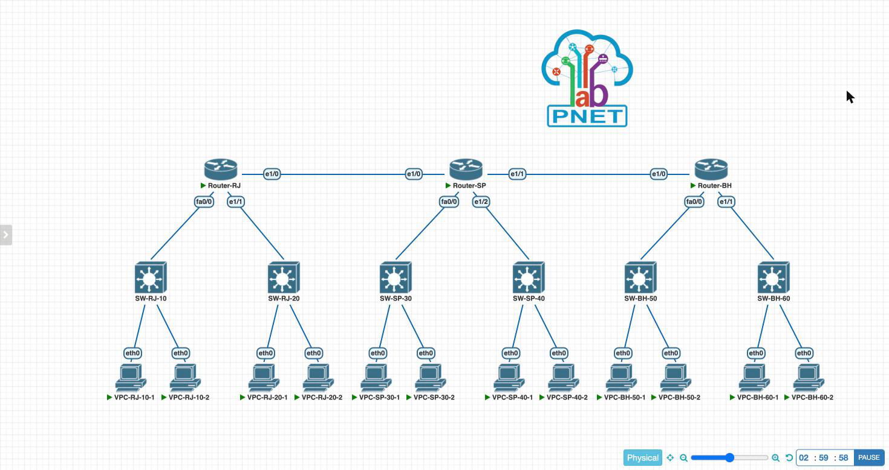

A topologia foi montada no PNetLab com 3 roteadores Cisco 7200 (Dynamips, IOS 15.2(4)S6), 6 switches (*bridges* do PNetLab) e 12 hosts VPCS, dois em cada LAN. Os roteadores receberam a placa `PA-4E` no slot 1, que fornece as interfaces `Ethernet1/0` a `Ethernet1/3`, além da `FastEthernet0/0` nativa. As conexões foram:

- Router-RJ `Ethernet1/0` ↔ Router-SP `Ethernet1/0` (WAN `172.16.100.0/24`)
- Router-SP `Ethernet1/1` ↔ Router-BH `Ethernet1/0` (WAN `172.16.200.0/24`)
- cada roteador liga `FastEthernet0/0` a uma LAN e uma `Ethernet1/x` à outra, cada LAN com seu switch e dois VPCs

Duas adaptações em relação ao roteiro:

- **Plataforma:** a imagem IOL usada nos Laboratórios 2 a 4 continua sem iniciar no servidor (o mesmo problema registrado no Laboratório 6), por isso foi usado o c7200. Ele roda o mesmo IOS clássico, e todos os comandos do roteiro valem sem mudança de sintaxe.
- **Nomes das interfaces:** o roteiro usa `g0/0`, `g0/1`, `f0/0` e `f0/1`, combinação que não existe no emulador (o IOS rejeita `interface g0/0`, como registrado no P3). Foi usado o mapeamento da tabela abaixo, mantendo a função de cada interface.

| Roteiro | Router-RJ | Router-SP | Router-BH |
| --- | --- | --- | --- |
| `g0/0` (WAN) | Ethernet1/0 | Ethernet1/0 | Ethernet1/0 |
| `g0/1` (WAN SP-BH) | — | Ethernet1/1 | — |
| `f0/0` (1ª LAN) | FastEthernet0/0 | FastEthernet0/0 | FastEthernet0/0 |
| `f0/1` (2ª LAN) | Ethernet1/1 | Ethernet1/2 | Ethernet1/1 |

## Parte 2 - Endereçamento IP

| Dispositivo | Interface | Endereço IP | Máscara | Função |
| --- | --- | --- | --- | --- |
| Router-RJ | Et1/0 | 172.16.100.1 | 255.255.255.0 | WAN para SP |
| Router-RJ | Fa0/0 | 172.16.10.254 | 255.255.255.0 | LAN RJ-10 |
| Router-RJ | Et1/1 | 172.16.20.254 | 255.255.255.0 | LAN RJ-20 |
| Router-SP | Et1/0 | 172.16.100.2 | 255.255.255.0 | WAN para RJ |
| Router-SP | Et1/1 | 172.16.200.1 | 255.255.255.0 | WAN para BH |
| Router-SP | Fa0/0 | 172.16.30.254 | 255.255.255.0 | LAN SP-30 |
| Router-SP | Et1/2 | 172.16.40.254 | 255.255.255.0 | LAN SP-40 |
| Router-BH | Et1/0 | 172.16.200.2 | 255.255.255.0 | WAN para SP |
| Router-BH | Fa0/0 | 172.16.50.254 | 255.255.255.0 | LAN BH-50 |
| Router-BH | Et1/1 | 172.16.60.254 | 255.255.255.0 | LAN BH-60 |

Os 12 VPCs seguiram a Seção 5.3 do roteiro: hosts `.1` e `.2` de cada LAN, com gateway `.254`. Os nomes usados no PNetLab são os da tabela 5.3 (`VPC-RJ-10-1`, `VPC-RJ-10-2`, …), já que o diagrama do roteiro usa outra numeração (`VPC-RJ-1` a `VPC-RJ-4`) para os mesmos hosts.

## Parte 3 - Configuração dos hosts

Em cada VPC, conforme a Seção 7 do roteiro:

```
ip <endereço> 255.255.255.0 <gateway>
save
```

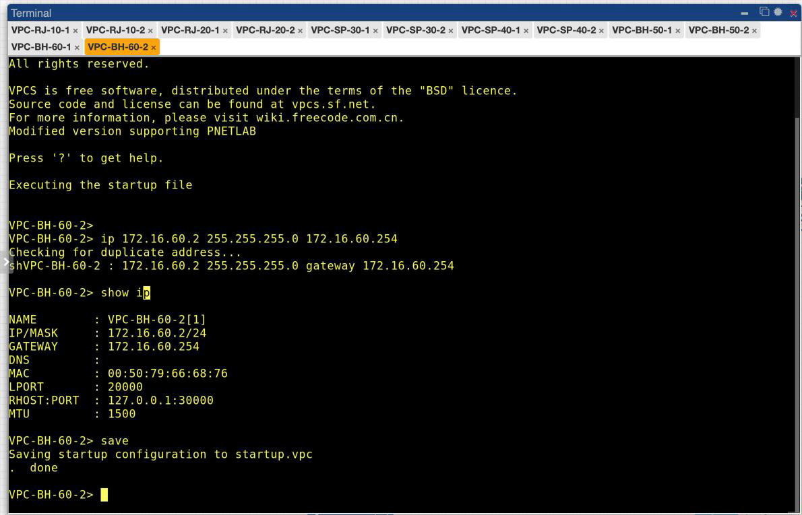

O print mostra o exemplo do próprio roteiro, o `VPC-BH-60-2` (`172.16.60.2/24`, gateway `172.16.60.254`), com `show ip` confirmando o endereço e o `save` gravando o `startup.vpc`.

## Parte 4 - Configuração das interfaces dos roteadores

### 1. Router-RJ

```bash
enable
configure terminal
hostname Router-RJ
no ip domain lookup
interface Ethernet1/0
 ip address 172.16.100.1 255.255.255.0
 no shut
interface FastEthernet0/0
 ip address 172.16.10.254 255.255.255.0
 no shut
interface Ethernet1/1
 ip address 172.16.20.254 255.255.255.0
 no shut
end
write memory
```

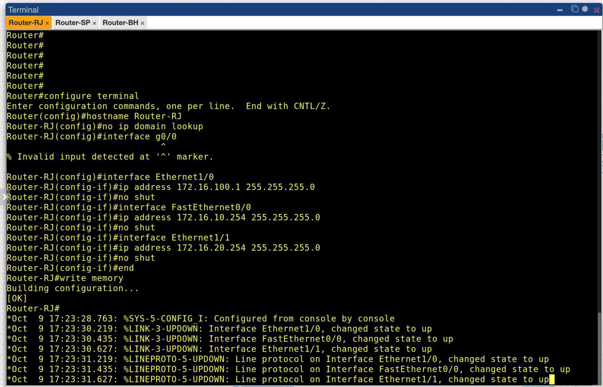

O comando `interface g0/0` do roteiro foi digitado primeiro, de propósito, para registrar o erro: `% Invalid input detected at '^' marker`. Em seguida as três interfaces foram configuradas com os nomes reais e subiram (`changed state to up`).

### 2. Router-SP

```bash
enable
configure terminal
hostname Router-SP
no ip domain lookup
interface Ethernet1/0
 ip address 172.16.100.2 255.255.255.0
 no shut
interface Ethernet1/1
 ip address 172.16.200.1 255.255.255.0
 no shut
interface FastEthernet0/0
 ip address 172.16.30.254 255.255.255.0
 no shut
interface Ethernet1/2
 ip address 172.16.40.254 255.255.255.0
 no shut
end
write memory
```

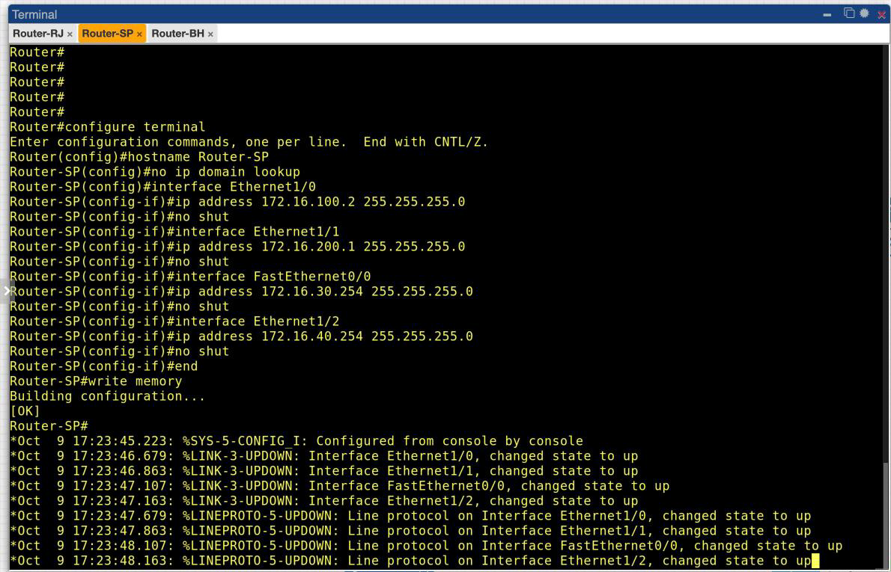

### 3. Router-BH

```bash
enable
configure terminal
hostname Router-BH
no ip domain lookup
interface Ethernet1/0
 ip address 172.16.200.2 255.255.255.0
 no shut
interface FastEthernet0/0
 ip address 172.16.50.254 255.255.255.0
 no shut
interface Ethernet1/1
 ip address 172.16.60.254 255.255.255.0
 no shut
end
write memory
```

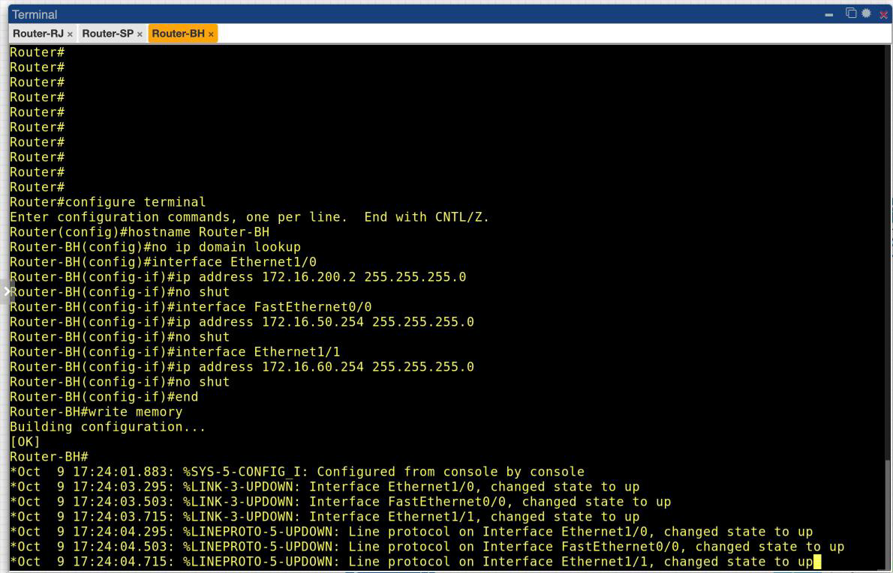

Foi acrescentado `write memory` ao fim de cada bloco, que o roteiro só pede na Seção 11.

## Parte 5 - Verificação inicial sem roteamento dinâmico

```bash
show ip route
ping 172.16.10.1
```

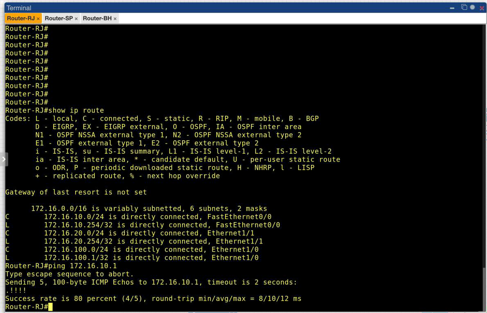

Antes de qualquer protocolo, a tabela do Router-RJ contém apenas rotas `C` (redes conectadas) e `L` (endereços locais `/32`) das suas três interfaces. O ping para o host da própria LAN (`172.16.10.1`) funciona. O primeiro `.` é a resolução ARP, e os quatro `!` seguintes são as respostas.

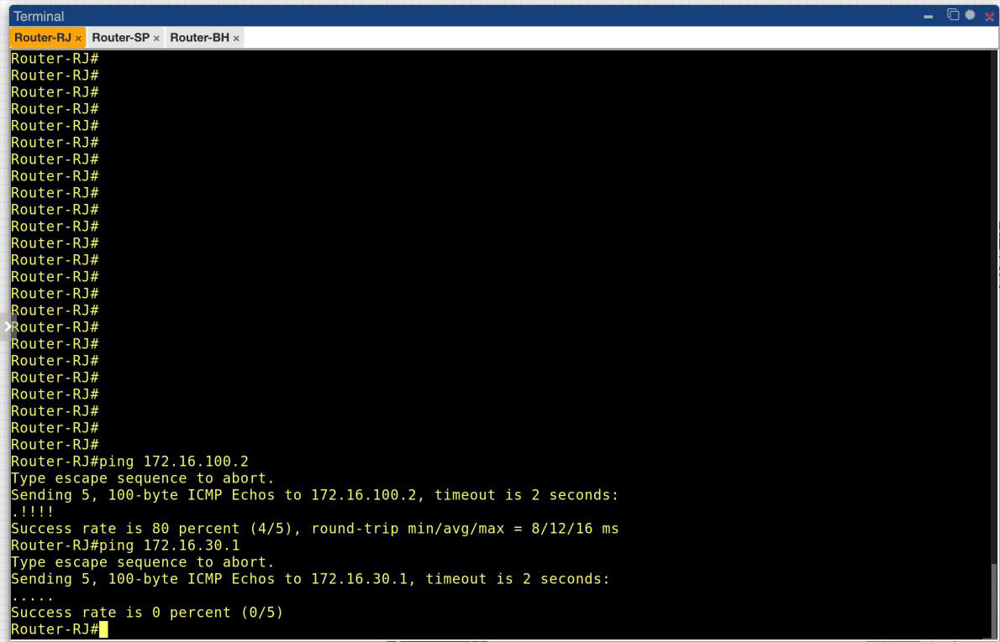

O ping para o vizinho da WAN (`172.16.100.2`) também funciona, porque a rede é diretamente conectada. Já o ping para `172.16.30.1`, uma LAN de São Paulo, falha com 0%: o Router-RJ não tem rota para `172.16.30.0/24` e descarta os pacotes. É exatamente o resultado esperado pela Seção 8 do roteiro.

## Parte 6 - RIP

### 1. Configuração

Nos três roteadores, conforme a Seção 9:

```bash
configure terminal
router rip
 network 172.16.0.0
end
```

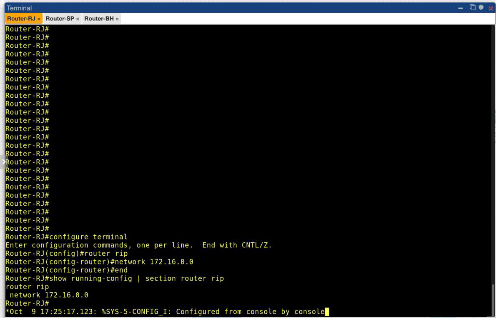

Um único `network 172.16.0.0` basta, porque o RIP trabalha com a rede *classful*. Como `172.16.0.0` é classe B, o comando habilita o RIP em todas as interfaces da faixa `172.16.0.0/16`, ou seja, em todas as interfaces do cenário.

### 2. Tabela de rotas com RIP

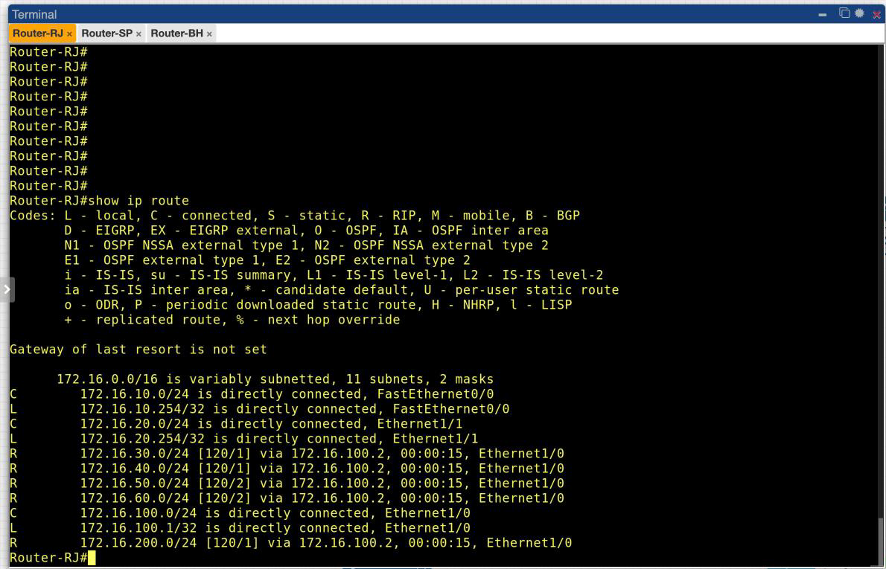

```
R    172.16.30.0/24  [120/1] via 172.16.100.2, Ethernet1/0
R    172.16.40.0/24  [120/1] via 172.16.100.2, Ethernet1/0
R    172.16.50.0/24  [120/2] via 172.16.100.2, Ethernet1/0
R    172.16.60.0/24  [120/2] via 172.16.100.2, Ethernet1/0
R    172.16.200.0/24 [120/1] via 172.16.100.2, Ethernet1/0
```

Em menos de 30 segundos o Router-RJ aprendeu as cinco redes remotas. O primeiro número entre colchetes é a distância administrativa do RIP (120). O segundo é a métrica em **saltos**: as LANs de São Paulo estão a 1 salto, e as de Belo Horizonte a 2. A métrica só conta roteadores atravessados. As duas LANs de SP aparecem com métrica 1, embora uma esteja numa FastEthernet (100 Mb/s) e a outra numa Ethernet (10 Mb/s).

### 3. `show ip protocols`

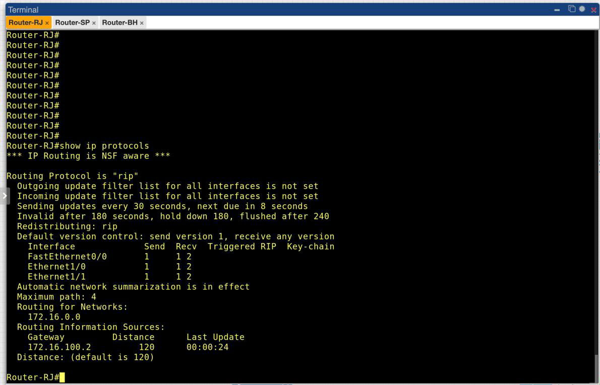

A saída mostra os temporizadores clássicos do RIP: *update* a cada 30 s, *invalid* em 180 s, *holddown* 180 s e *flush* em 240 s. Mostra também `send version 1, receive any version` e `Automatic network summarization is in effect`. Como o roteiro não especifica `version 2`, o processo ficou em **RIPv1**, que é *classful*. Neste cenário isso não causou problema: todas as sub-redes pertencem à mesma rede classe B e usam a mesma máscara `/24`, condição em que o RIPv1 funciona. Em uma rede com máscaras variáveis ou com redes descontínuas, seria preciso acrescentar `version 2` e `no auto-summary`.

### 4. Conectividade

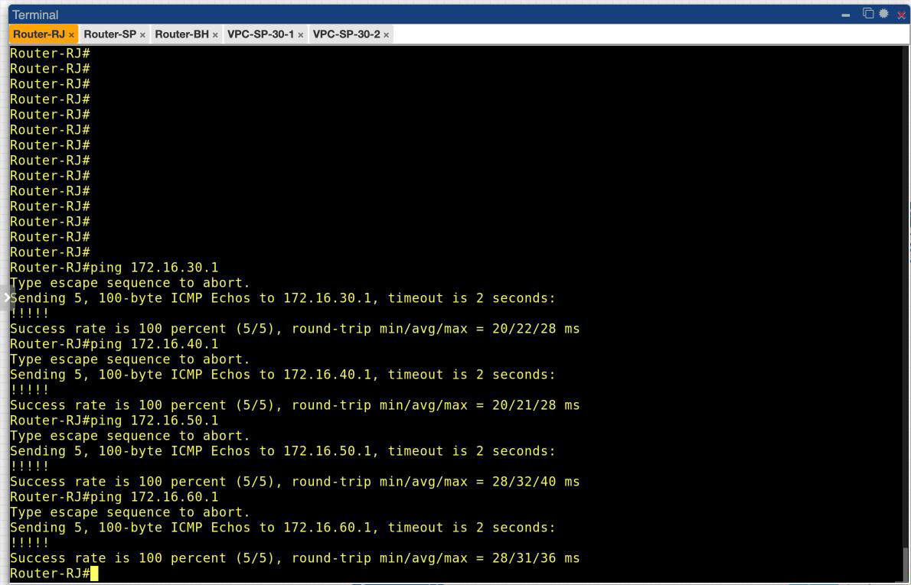

Os quatro pings da Seção 10 (`172.16.30.1`, `.40.1`, `.50.1` e `.60.1`) tiveram 100% de sucesso. As latências maiores para BH (28 a 40 ms, contra 20 a 28 ms para SP) refletem o salto adicional.

**Ocorrência durante a execução.** Na primeira rodada, o ping para `172.16.30.1` falhou, e o ARP do Router-SP mostrava `Incomplete` para os dois hosts dessa LAN. Os dois VPCs da LAN SP-30 estavam sem endereço: o comando `ip` não tinha sido registrado na configuração inicial pelo console web. Depois de reconfigurá-los, todos os 12 hosts responderam ao Router-SP.

### 5. Situação 3 do troubleshooting: remoção do RIP de um roteador

O roteiro coloca a Situação 3 ("remover o RIP de um roteador") depois do OSPF. Nessa altura o RIP já foi removido de todos os roteadores na Seção 11, então o teste não teria efeito algum. Por isso ele foi executado aqui, com o RIP ainda ativo, para medir o comportamento do protocolo.

No Router-BH, às 17:30:42:

```bash
configure terminal
no router rip
end
```

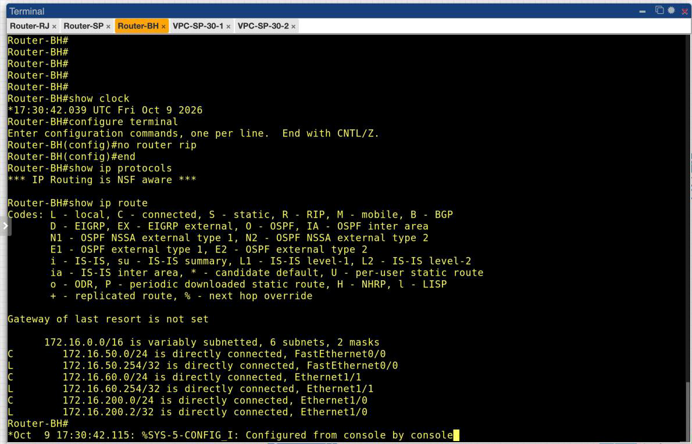

O Router-BH ficou imediatamente só com as rotas conectadas, e o `show ip protocols` voltou vazio. A pergunta interessante é quanto tempo o resto da rede leva para perceber.

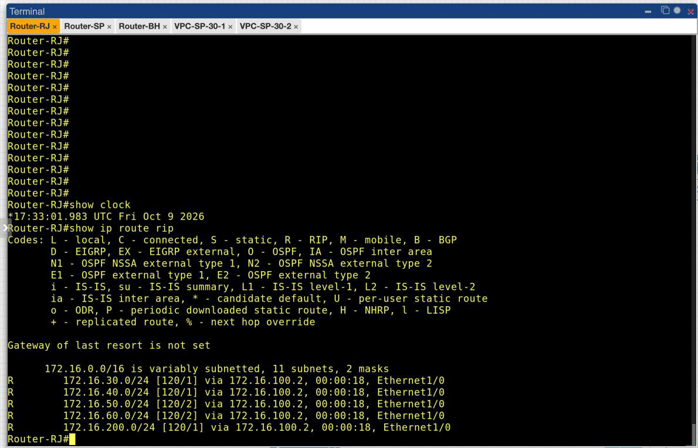

Às **17:33:01**, 139 s depois, o Router-RJ **ainda tinha** as rotas `172.16.50.0/24` e `172.16.60.0/24`, com idade de apenas 18 s. O Router-SP, que as aprendera do BH, continuava repassando-as a cada 30 s, porque para ele elas ainda não tinham expirado. Ao sair do processo, o BH simplesmente parou de falar e não avisou ninguém. O SP só deduz a falha pelo silêncio, quando o temporizador *invalid* de 180 s expira.

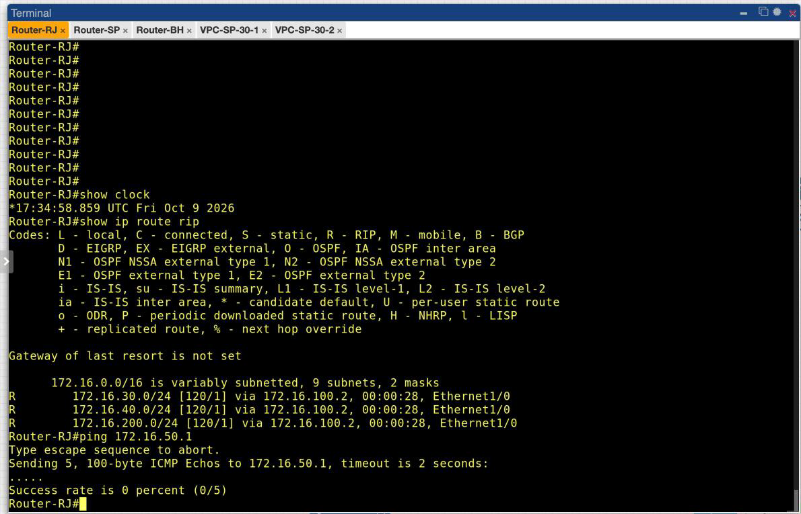

Às **17:34:58**, 256 s depois, as rotas do BH tinham desaparecido do Router-RJ, e o ping para `172.16.50.1` falhou. O tempo total bate com os temporizadores: 180 s até o SP invalidar as rotas e envenená-las (métrica 16), e cerca de 240 s até o *flush*. Durante mais de três minutos, a rede encaminhou tráfego para BH por um caminho que já não existia.

### 6. Remoção do RIP (Seção 11)

```bash
configure terminal
no router rip
end
write memory
```

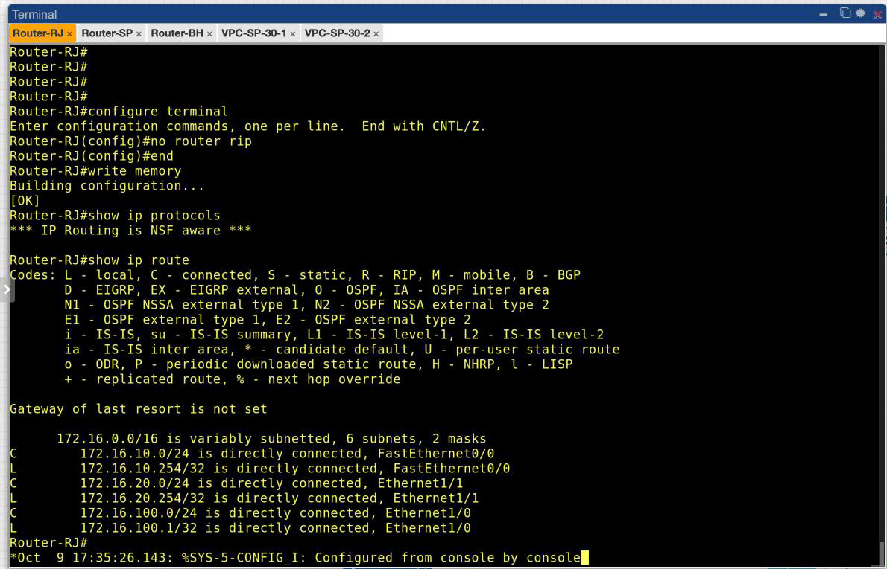

Com o RIP removido dos três roteadores, a tabela do Router-RJ voltou ao estado da Parte 5, só com rotas `C` e `L`. O cenário fica limpo para o OSPF.

## Parte 7 - OSPF

### 1. Configuração

Conforme a Seção 12 do roteiro, com processos 64 (RJ), 65 (SP) e 66 (BH), todos na área 0:

```bash
! Router-RJ
router ospf 64
 network 172.16.10.0 0.0.0.255 area 0
 network 172.16.20.0 0.0.0.255 area 0
 network 172.16.100.0 0.0.0.255 area 0

! Router-SP
router ospf 65
 network 172.16.30.0 0.0.0.255 area 0
 network 172.16.40.0 0.0.0.255 area 0
 network 172.16.100.0 0.0.0.255 area 0
 network 172.16.200.0 0.0.0.255 area 0

! Router-BH
router ospf 66
 network 172.16.50.0 0.0.0.255 area 0
 network 172.16.60.0 0.0.0.255 area 0
 network 172.16.200.0 0.0.0.255 area 0
```

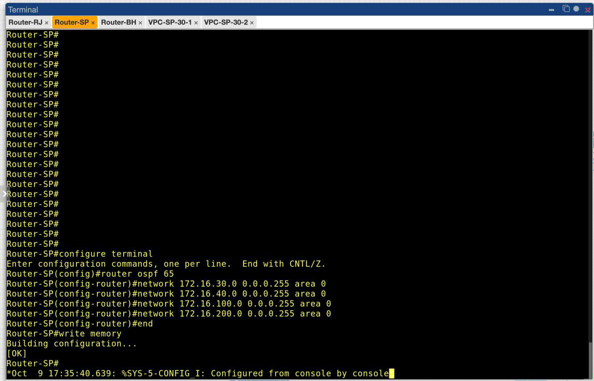

Diferente do RIP, cada rede é anunciada explicitamente, com sua *wildcard mask* e área.

### 2. Vizinhança

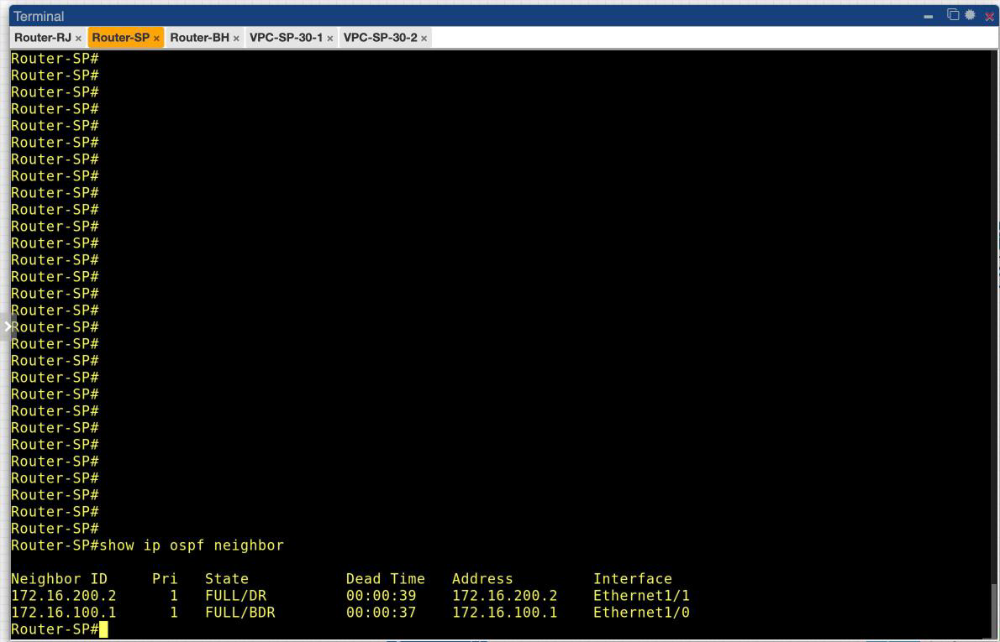

```
Neighbor ID     Pri   State      Dead Time   Address        Interface
172.16.200.2      1   FULL/DR    00:00:39    172.16.200.2   Ethernet1/1
172.16.100.1      1   FULL/BDR   00:00:37    172.16.100.1   Ethernet1/0
```

O Router-SP formou adjacência **FULL** com os dois vizinhos, RJ e BH. A formação deu certo apesar de cada roteador usar um **número de processo diferente** (64, 65 e 66). O ID de processo OSPF é local ao roteador e não é transmitido nos pacotes Hello. O que precisa coincidir entre vizinhos é área, rede, máscara, temporizadores e autenticação. Como os enlaces são Ethernet (multiacesso), em cada um houve eleição de DR/BDR. O *Router ID* de cada roteador foi escolhido automaticamente como o maior IP de interface ativa: `172.16.100.1` (RJ), `172.16.200.1` (SP) e `172.16.200.2` (BH).

### 3. Tabela de rotas com OSPF

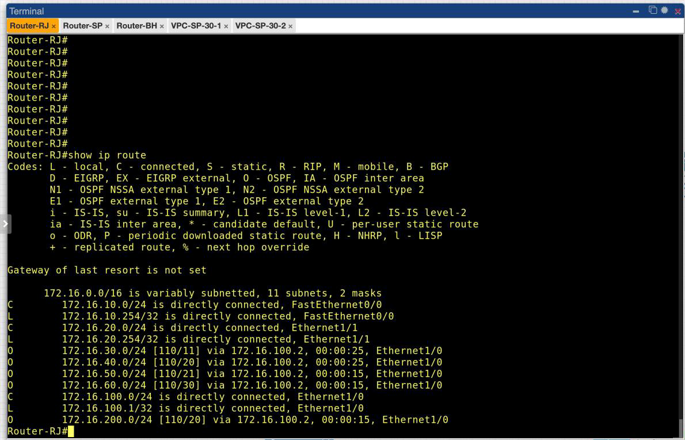

```
O    172.16.30.0/24  [110/11] via 172.16.100.2, Ethernet1/0
O    172.16.40.0/24  [110/20] via 172.16.100.2, Ethernet1/0
O    172.16.50.0/24  [110/21] via 172.16.100.2, Ethernet1/0
O    172.16.60.0/24  [110/30] via 172.16.100.2, Ethernet1/0
O    172.16.200.0/24 [110/20] via 172.16.100.2, Ethernet1/0
```

As mesmas cinco redes aparecem, agora com o código `O`, distância administrativa 110 e **custo** baseado em largura de banda (`10⁸ / bandwidth`): FastEthernet custa 1 e Ethernet de 10 Mb/s custa 10. Os valores conferem com a soma das interfaces de saída ao longo de cada caminho:

| Destino | Caminho | Custo |
| --- | --- | --- |
| 172.16.30.0/24 | WAN RJ-SP (10) + Fa0/0 do SP (1) | 11 |
| 172.16.40.0/24 | WAN RJ-SP (10) + Et1/2 do SP (10) | 20 |
| 172.16.50.0/24 | WAN RJ-SP (10) + WAN SP-BH (10) + Fa0/0 do BH (1) | 21 |
| 172.16.60.0/24 | WAN RJ-SP (10) + WAN SP-BH (10) + Et1/1 do BH (10) | 30 |

Esse é o contraste mais direto com o RIP. As LANs `30` e `40` tinham a mesma métrica no RIP (1 salto), mas no OSPF diferem por quase o dobro, porque uma está em um enlace de 100 Mb/s e a outra em um de 10 Mb/s. A LAN `50`, a dois roteadores de distância, custa praticamente o mesmo que a `40`, a um roteador.

### 4. `show ip protocols`

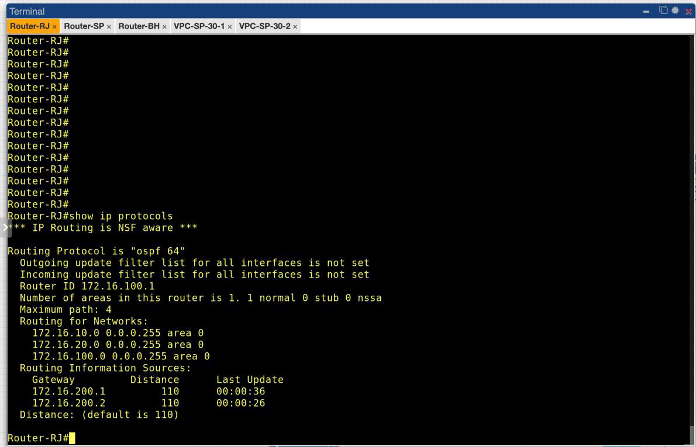

O processo `ospf 64` no Router-RJ mostra o *Router ID*, a quantidade de áreas (1 normal), as redes anunciadas com suas *wildcards* e as fontes de informação, que são os *Router IDs* do SP e do BH, com distância 110. Comparado ao RIP, o OSPF expõe mais estado operacional: vizinhos identificados por ID, papéis DR/BDR, *dead time* por vizinho e custo por interface.

### 5. Conectividade fim a fim (Seção 14.1)

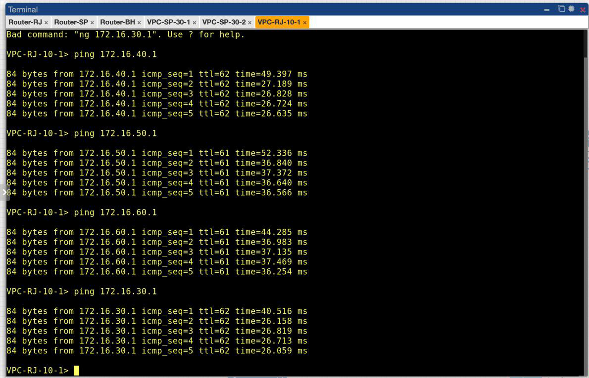

A partir do `VPC-RJ-10-1`, os quatro pings da Seção 14.1 tiveram 100% de sucesso. O TTL das respostas confirma o número de roteadores no caminho: **62** para SP (64 − 2 roteadores) e **61** para BH (64 − 3 roteadores).

## Parte 8 - Troubleshooting com OSPF

### Situação 1: remover uma rede do anúncio OSPF em São Paulo

O roteiro manda executar:

```bash
configure terminal
router ospf 1
 no network 172.16.40.0 0.0.0.255 area 0
end
```

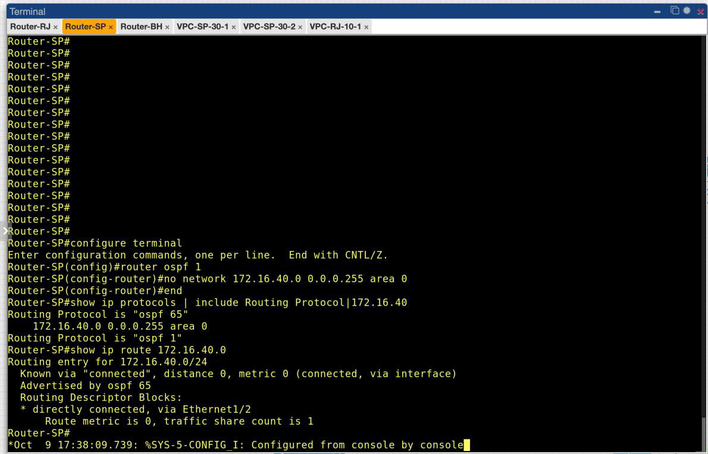

O comando **não tem o efeito pretendido**. O Router-SP roda o processo **65** (Seção 12.2), e `router ospf 1` cria silenciosamente um **novo processo vazio**, como mostra `show ip protocols` listando `ospf 65` e `ospf 1`. O `no network` é aplicado a esse processo novo, onde a rede nunca existiu, e o IOS não exibe erro. A rede `172.16.40.0/24` continua `Advertised by ospf 65`.

Com o processo correto:

```bash
configure terminal
no router ospf 1
router ospf 65
 no network 172.16.40.0 0.0.0.255 area 0
end
```

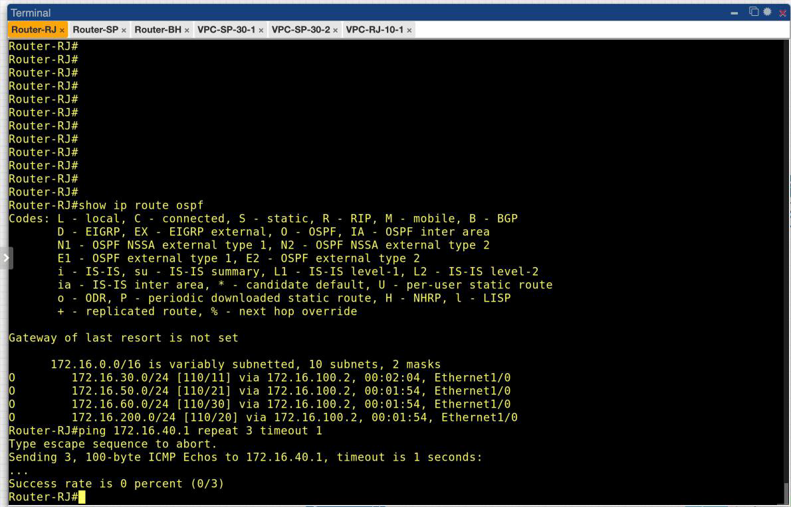

O processo espúrio foi removido e, no Router-RJ, a rota `172.16.40.0/24` desapareceu imediatamente da tabela OSPF. O ping para `172.16.40.1` passou a falhar. As demais LANs não foram afetadas. A configuração foi então restaurada (`network 172.16.40.0 0.0.0.255 area 0`), e a rota voltou, como se vê em P24 com idade de 18 s.

### Situação 2: interromper o enlace SP-BH

No Router-SP, sobre a interface que o roteiro chama de `g0/1` (aqui `Ethernet1/1`):

```bash
configure terminal
interface Ethernet1/1
 shutdown
end
```

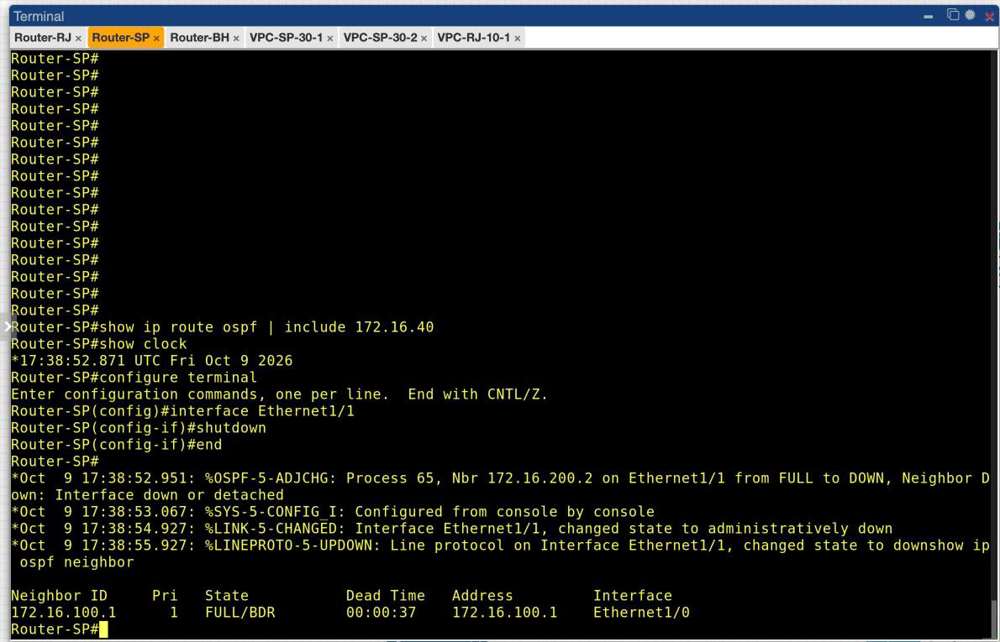

O `shutdown` foi aplicado às 17:38:52.87, e às **17:38:52.95** o log registrou `%OSPF-5-ADJCHG: ... from FULL to DOWN, Neighbor Down: Interface down or detached`, 80 ms depois. O `show ip ospf neighbor` passou a listar só o Router-RJ.

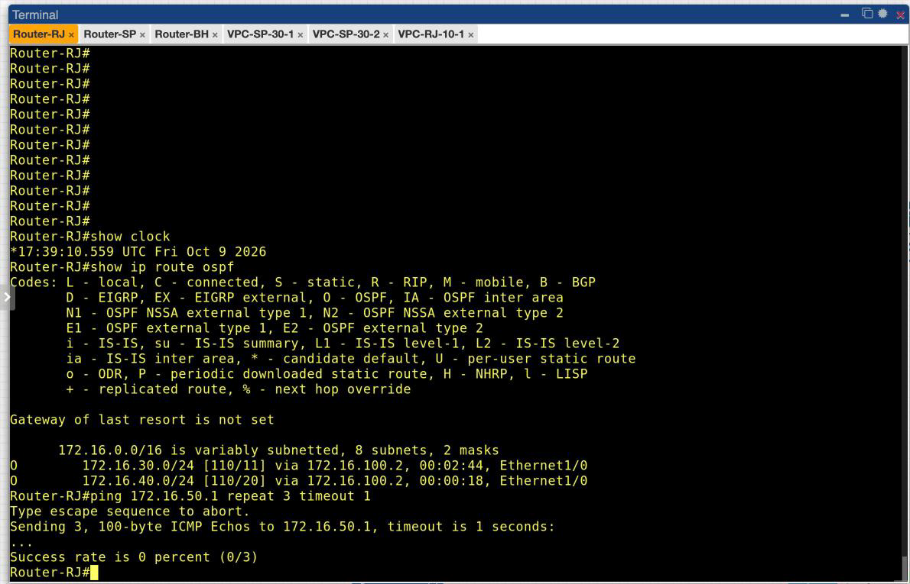

No Router-RJ, às 17:39:10, as rotas para `172.16.50.0/24`, `172.16.60.0/24` e `172.16.200.0/24` já tinham sido removidas e o ping para `172.16.50.1` falhava. O SP detectou a queda localmente, gerou um novo LSA e o inundou para o RJ, que recalculou a árvore SPF. Não houve espera por temporizador.

```bash
configure terminal
interface Ethernet1/1
 no shutdown
end
write memory
```

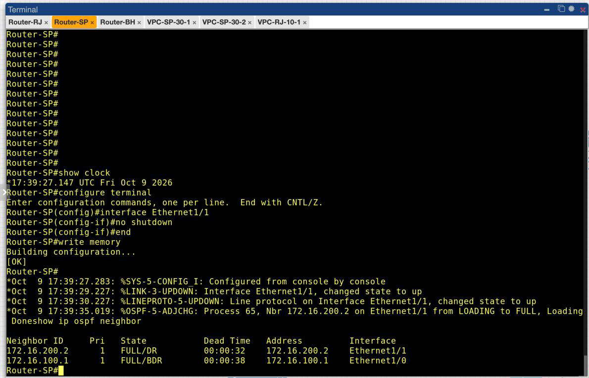

Na restauração, o `no shutdown` foi aplicado às 17:39:27. A interface subiu às 17:39:29, e a adjacência voltou a **FULL** às **17:39:35**, cerca de 8 s depois. O tempo é o da troca de Hellos e da sincronização das bases de dados (`LOADING to FULL, Loading Done`).

## Parte 9 - Comparação orientada entre RIP e OSPF

**1. Qual protocolo foi mais simples de configurar?**

O **RIP**. Um único comando, `network 172.16.0.0`, idêntico nos três roteadores, habilitou o protocolo em todas as interfaces. O OSPF exigiu um número de processo, uma linha por rede com *wildcard mask* e a área de cada uma, o que dá 3 ou 4 linhas por roteador, todas diferentes entre si. A Situação 1 mostrou o outro lado dessa riqueza: um número de processo errado criou um processo vazio sem nenhum aviso.

**2. Qual protocolo apresentou maior riqueza de informações operacionais?**

O **OSPF**. Além da tabela de rotas, ele mostrou vizinhos identificados por *Router ID*, estado da adjacência (`FULL`), papel no segmento (`DR`/`BDR`), *dead time* por vizinho e eventos de log detalhados como `FULL to DOWN` e `LOADING to FULL`. O RIP só oferece a lista de redes, os temporizadores e o "último update" de cada fonte. Por exemplo, ele não indica que um vizinho deixou de existir, apenas para de ouvi-lo.

**3. Qual a principal métrica do RIP?**

A **contagem de saltos** (*hop count*), com máximo de 15, sendo 16 tratado como infinito. Na prática, `172.16.30.0/24` e `172.16.40.0/24` ficaram com a mesma métrica 1, embora uma esteja num enlace de 100 Mb/s e a outra num de 10 Mb/s.

**4. Qual algoritmo é usado pelo OSPF?**

O **SPF (*Shortest Path First*) de Dijkstra**. Cada roteador mantém a base de dados de estado de enlace (LSDB) com a topologia completa da área e calcula a árvore de menor custo até cada destino. O custo de cada interface é derivado da largura de banda (`10⁸ / bandwidth`), o que produziu os custos 11, 20, 21 e 30 observados.

**5. Qual protocolo tende a escalar melhor?**

O **OSPF**. Ele envia atualizações só quando há mudança, e não a tabela inteira a cada 30 s. Permite dividir a rede em áreas hierárquicas para conter a inundação de LSAs e não tem limite de 15 saltos. O RIP também gasta banda com anúncios periódicos completos, gasto que cresce com o tamanho da tabela e o número de interfaces.

**6. Qual protocolo converge melhor em cenários maiores?**

O **OSPF**, e o laboratório mediu isso diretamente. No RIP, a saída silenciosa de um roteador levou **mais de 4 minutos** (entre 139 s e 256 s) para ser refletida no Router-RJ, que nesse intervalo continuou com rotas para um destino inalcançável. No OSPF, a queda de um enlace foi detectada em **80 ms** e refletida no Router-RJ em **menos de 18 s**, e a restauração completa levou cerca de **8 s**. O RIP só conhece o que os vizinhos dizem e precisa esperar temporizadores para concluir algo pelo silêncio. O OSPF inunda a mudança para toda a área e cada roteador recalcula sozinho, a partir do mapa completo. Em redes maiores, com mais saltos entre a falha e o observador, essa diferença só aumenta.

## Conclusão

O laboratório cumpriu o objetivo de configurar e comparar RIP e OSPF na mesma topologia de três roteadores e seis LANs. Antes do roteamento dinâmico, cada roteador alcançava apenas suas redes conectadas. Com qualquer um dos dois protocolos, as 12 estações passaram a se comunicar entre as três cidades sem nenhuma rota estática.

O que mais distinguiu os dois protocolos não foi a tabela final, praticamente igual nos dois casos, mas **como cada um chega a ela**. O RIP é simples de configurar e mede distância em saltos, sem distinguir um enlace de 100 Mb/s de um de 10 Mb/s. Sua convergência depende de temporizadores, e uma falha sem aviso levou mais de quatro minutos para ser absorvida. 

O OSPF exigiu mais configuração, mas mediu os caminhos pela capacidade dos enlaces, expôs o estado de cada vizinho e reagiu à queda de um enlace em fração de segundo. É essa diferença que torna o RIP aceitável apenas em redes pequenas e estáveis, e o OSPF o IGP padrão em redes corporativas maiores.
