# Relatório 6 - Laboratório 6
**Arthur Choi Braga - 242014300**

Laboratório 06 - Roteamento Externo via BGP
Disciplina ENE0025 - Protocolos de Transporte e Roteamento

## Objetivo

Configurar o BGP no roteador de borda da empresa (R1, AS 1000) para anunciar o prefixo público `200.18.245.64/27` aos provedores ISP1 (AS 100) e ISP2 (AS 200). Com o ISP1, a vizinhança é feita entre loopbacks. Com o ISP2, é feita pelo endereço físico do enlace.

## Parte 1 - Setup da topologia

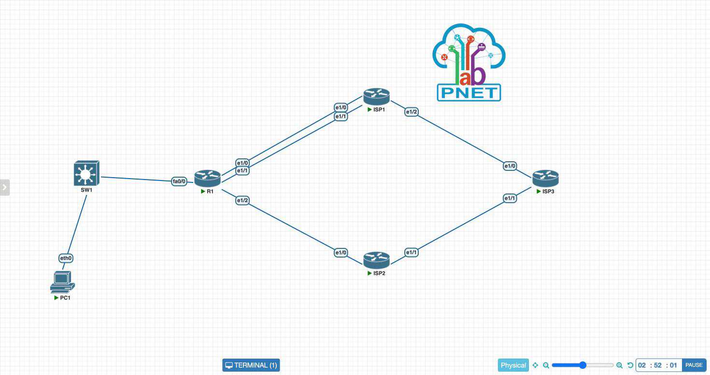

A topologia foi montada no PNetLab com 4 roteadores Cisco 7200 (Dynamips, IOS 15.2(4)S6), 1 switch (bridge do PNetLab) e 1 host VPCS na LAN da empresa. As conexões foram:

- PC1 `eth0` → SW1 → R1 `FastEthernet0/0` (LAN `192.168.0.0/24`)
- R1 `Ethernet1/0` → ISP1 `Ethernet1/0` (`10.1.0.0/30`)
- R1 `Ethernet1/1` → ISP1 `Ethernet1/1` (`10.1.0.4/30`)
- R1 `Ethernet1/2` → ISP2 `Ethernet1/0` (`10.2.0.0/30`)
- ISP1 `Ethernet1/2` → ISP3 `Ethernet1/0` (`191.1.0.0/30`)
- ISP2 `Ethernet1/1` → ISP3 `Ethernet1/1` (`191.2.0.0/30`)

Os roteadores receberam a placa `PA-4E` no slot 1, que fornece as quatro interfaces `Ethernet1/0` a `Ethernet1/3`.

**Por que c7200 e não IOL.** Nos laboratórios anteriores foi usada a imagem IOL. Neste, todos os nós IOL (as duas imagens L3 e a L2 disponíveis) passavam a `stopped` logo após o *start*, inclusive um nó criado direto pelo assistente padrão do PNetLab. O problema estava no servidor, não na configuração. O c7200 iniciou normalmente e roda o mesmo IOS clássico, então todos os comandos do roteiro valem sem mudança de sintaxe. Pela mesma razão, o SW1 foi implementado como *bridge* do PNetLab em vez de um switch IOL L2.

## Parte 2 - Endereçamento IP

| Dispositivo | Interface | Endereço IP | Máscara | Observação |
| --- | --- | --- | --- | --- |
| R1 | Loopback1 | 11.11.11.11 | 255.255.255.255 | Origem da sessão BGP com o ISP1 |
| R1 | Fa0/0 | 192.168.0.1 | 255.255.255.0 | LAN da empresa (SW1) |
| R1 | Et1/0 | 10.1.0.1 | 255.255.255.252 | Enlace 1 com ISP1 (roteiro: `g0/1`) |
| R1 | Et1/1 | 10.1.0.5 | 255.255.255.252 | Enlace 2 com ISP1 (roteiro: `g0/2`) |
| R1 | Et1/2 | 10.2.0.1 | 255.255.255.252 | Enlace com ISP2 (roteiro: `g0/3`) |
| PC1 | eth0 | 192.168.0.10 | 255.255.255.0 | Gateway 192.168.0.1 |

## Parte 3 - Configuração do R1

### 1. Interfaces

```bash
enable
configure terminal
hostname R1
no ip domain lookup

interface loopback 1
 ip address 11.11.11.11 255.255.255.255
 no shut

interface FastEthernet0/0
 ip address 192.168.0.1 255.255.255.0
 no shut

interface Ethernet1/0
 ip address 10.1.0.1 255.255.255.252
 no shut

interface Ethernet1/1
 ip address 10.1.0.5 255.255.255.252
 no shut

interface Ethernet1/2
 ip address 10.2.0.1 255.255.255.252
 no shut
end
```

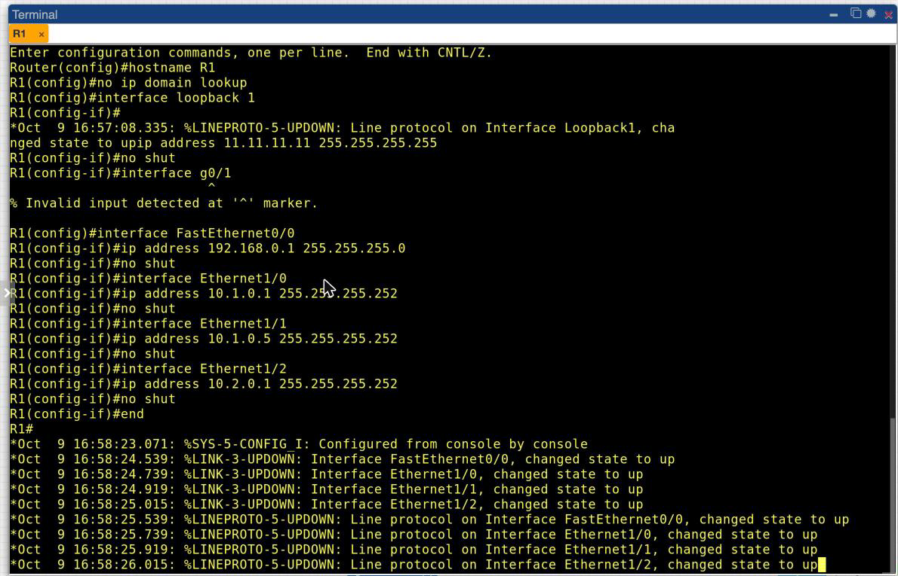

O comando `interface g0/1` do roteiro foi digitado de propósito antes das interfaces corretas, para registrar o erro: o IOS responde `% Invalid input detected at '^' marker` e volta ao modo `(config)`. Se o roteiro fosse seguido literalmente, os comandos `ip address` e `no shut` seguintes seriam digitados no modo de configuração global e rejeitados, e os três enlaces com os provedores ficariam sem endereço.

```bash
show ip interface brief
```

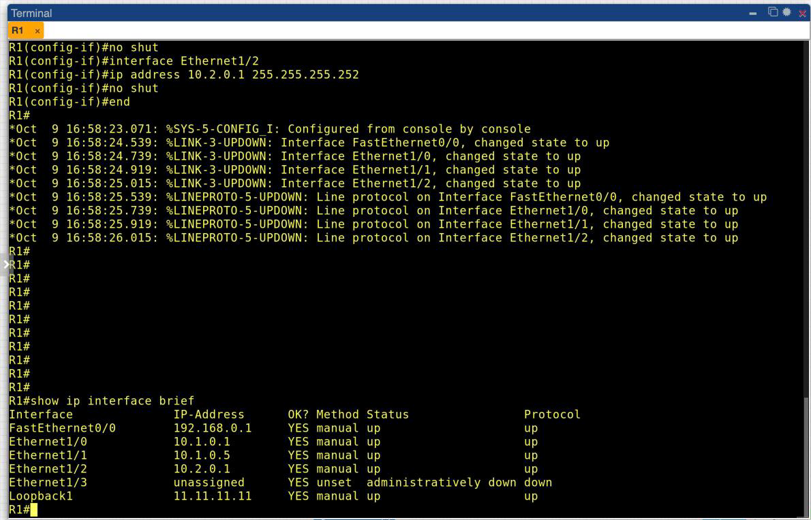

As quatro interfaces usadas e a Loopback1 estão `up/up` com os endereços previstos. A `Ethernet1/3` fica `administratively down`, sem uso.

### 2. BGP

```bash
configure terminal
router bgp 1000
 neighbor 10.10.10.10 remote-as 100
 neighbor 10.10.10.10 password SENHA
 neighbor 10.10.10.10 ebgp-multihop 2
 neighbor 10.10.10.10 update-source Loopback1
 neighbor 10.2.0.2 remote-as 200
 neighbor 10.2.0.2 password SENHA
 network 200.18.245.64 mask 255.255.255.224
 exit
ip route 10.10.10.10 255.255.255.255 10.1.0.2
ip route 10.10.10.10 255.255.255.255 10.1.0.6
ip route 200.18.245.64 255.255.255.224 Null0
end
write memory
```

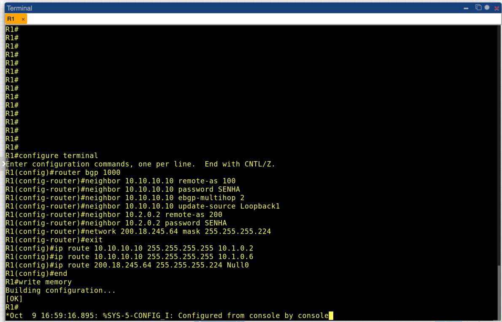

Todos os comandos foram aceitos sem erro, e o `write memory` gravou a configuração na NVRAM (`[OK]`).

## Parte 4 - Verificação

### 1. `show ip bgp summary`

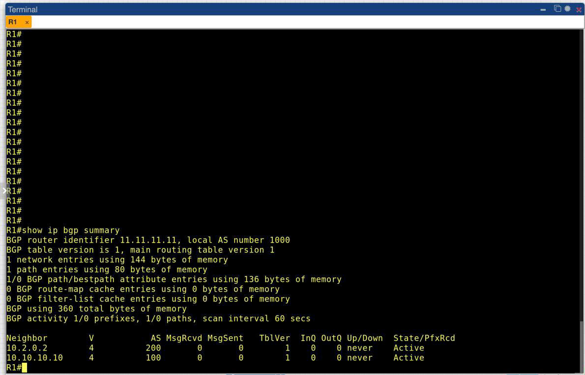

```
BGP router identifier 11.11.11.11, local AS number 1000
Neighbor        V    AS MsgRcvd MsgSent   TblVer  InQ OutQ Up/Down  State/PfxRcd
10.2.0.2        4   200       0       0        1    0    0 never    Active
10.10.10.10     4   100       0       0        1    0    0 never    Active
```

O processo BGP subiu no AS 1000. O *router-id* `11.11.11.11` foi escolhido automaticamente como o maior endereço de loopback. Os dois vizinhos estão configurados com os AS corretos, mas nenhuma sessão estabeleceu: `MsgRcvd`/`MsgSent` zerados e `Up/Down = never`. O estado `Active` indica que o R1 tenta abrir a conexão TCP na porta 179 e não recebe resposta. É o resultado esperado com os ISPs sem configuração (item 5 da Parte 2).

### 2. `show ip bgp`

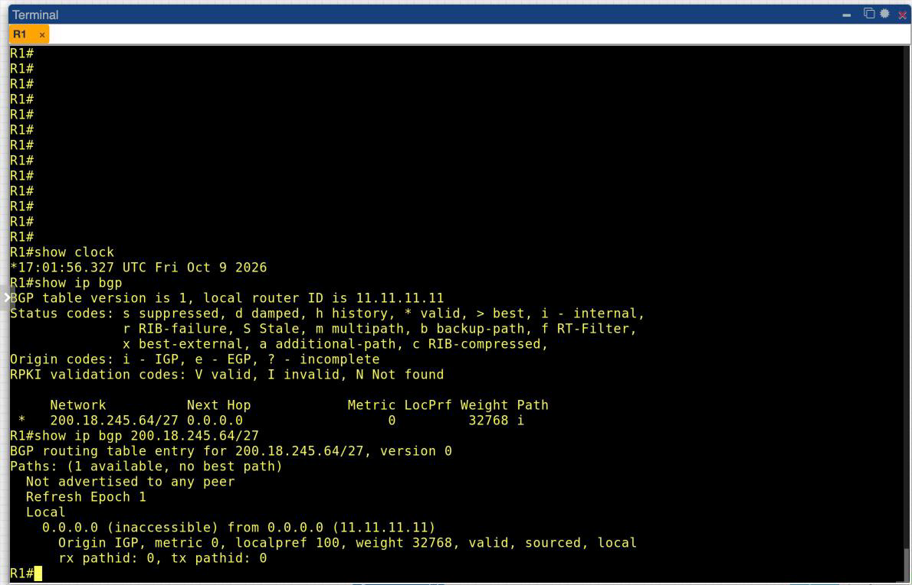

```
     Network          Next Hop            Metric LocPrf Weight Path
 *   200.18.245.64/27 0.0.0.0                  0         32768 i
```

O comando `network` funcionou: o prefixo `200.18.245.64/27` entrou na tabela BGP como rota originada localmente (próximo salto `0.0.0.0`, *weight* 32768, origem `i`). Isso só acontece porque existe na tabela de roteamento uma rota com prefixo e máscara **exatamente iguais**, que é a rota para `Null0`.

A entrada aparece com `*` (válida), mas **sem `>`**, e o detalhe do prefixo mostra `Paths: (1 available, no best path)` e `Not advertised to any peer`. A tabela continua na versão 1 mesmo dois minutos depois. Esse é um comportamento do IOS: ao iniciar, o processo BGP entra em *read-only mode* e só executa a seleção de melhor caminho depois que o primeiro vizinho chega a `Established`. Sem nenhum vizinho ativo, o prefixo fica parado na tabela, válido mas não eleito. Mesmo com toda a configuração do R1 correta, **o anúncio só acontece de fato quando os provedores forem configurados**. Esse é o limite prático do Lab 6 isolado.

### 3. `show ip route`

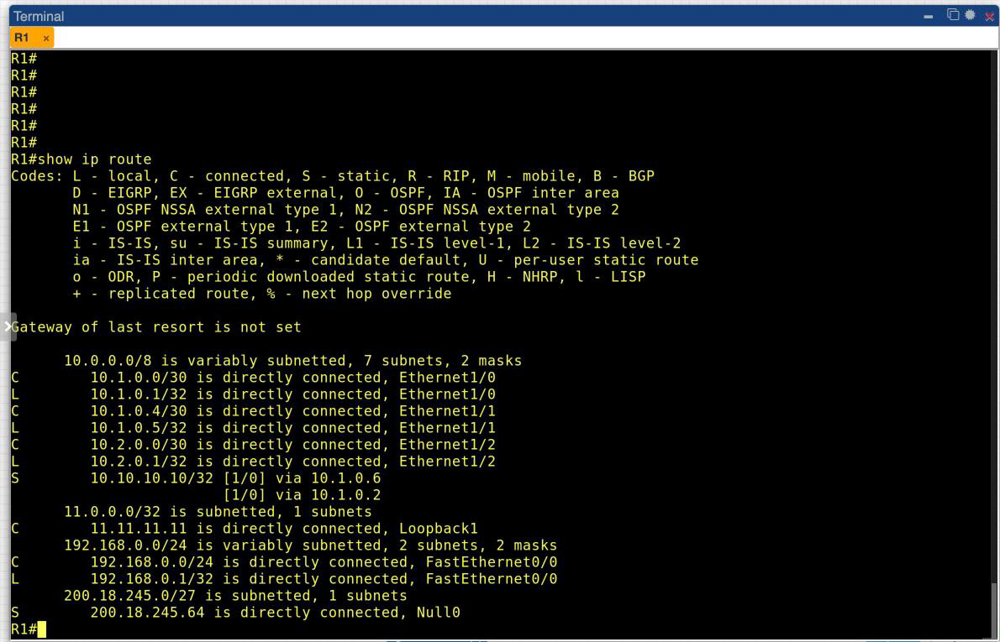

```
S        10.10.10.10/32 [1/0] via 10.1.0.6
                        [1/0] via 10.1.0.2
C        11.11.11.11 is directly connected, Loopback1
S        200.18.245.64 is directly connected, Null0
```

As duas rotas estáticas para a loopback do ISP1 foram instaladas lado a lado, com a mesma distância administrativa e métrica `[1/0]`. O R1 divide o tráfego para `10.10.10.10` entre os dois enlaces, o que garante redundância para a sessão BGP: se um dos enlaces cair, o outro continua levando ao vizinho. A rota `200.18.245.64/27 → Null0` também aparece. Ela é a âncora do anúncio BGP.

Com a forma corrigida (próximo salto), as estáticas já ficam instaladas com o ISP1 ainda desligado, porque `10.1.0.2` e `10.1.0.6` são resolvidos pelas redes diretamente conectadas.

### 4. Sessão com loopback: `show ip bgp neighbors`

```bash
show ip bgp neighbors 10.10.10.10 | include BGP neighbor|BGP state|hops|...
show ip bgp neighbors 10.2.0.2 | include BGP neighbor|BGP state|hops|TTL
```

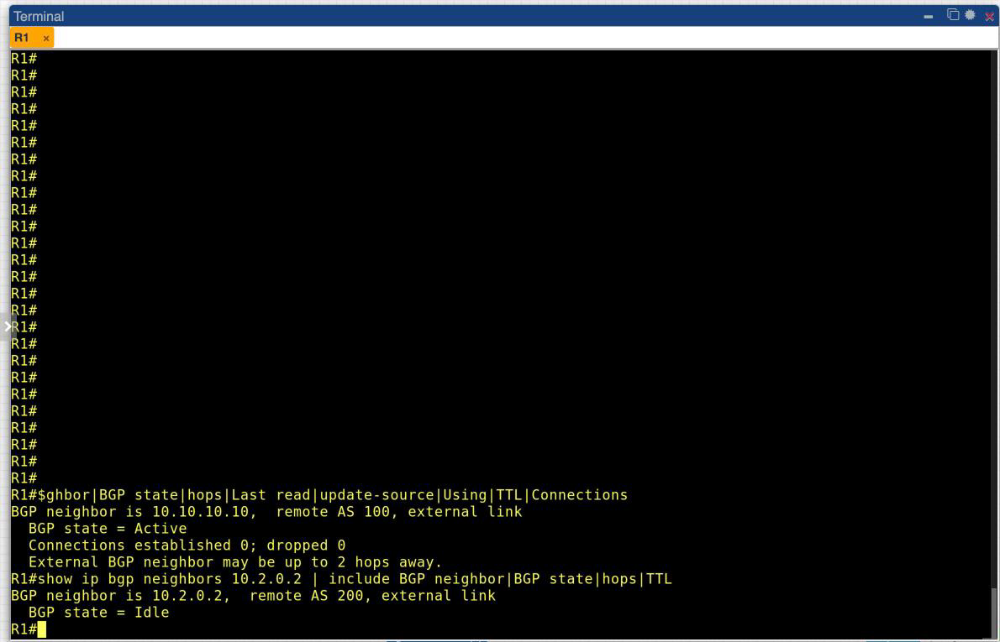

```
BGP neighbor is 10.10.10.10,  remote AS 100, external link
  BGP state = Active
  Connections established 0; dropped 0
  External BGP neighbor may be up to 2 hops away.
BGP neighbor is 10.2.0.2,  remote AS 200, external link
  BGP state = Idle
```

A linha `External BGP neighbor may be up to 2 hops away` é a evidência do `ebgp-multihop 2`. Para o vizinho `10.2.0.2` essa linha não aparece, porque ele usa o padrão eBGP de TTL 1 (vizinho diretamente conectado).

### 5. `show running-config`

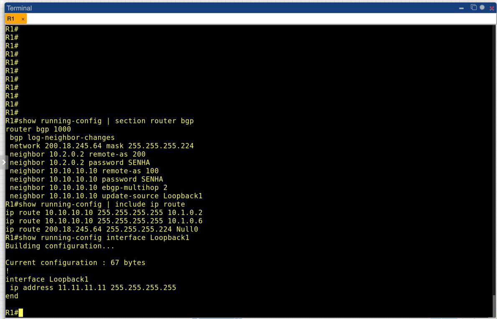

O trecho `router bgp 1000` confirma os parâmetros aplicados. O IOS acrescentou sozinho `bgp log-neighbor-changes`, que é padrão. As senhas aparecem em texto claro porque não foi habilitado `service password-encryption`. Em produção, isso seria recomendável.

### 6. Verificação nos provedores

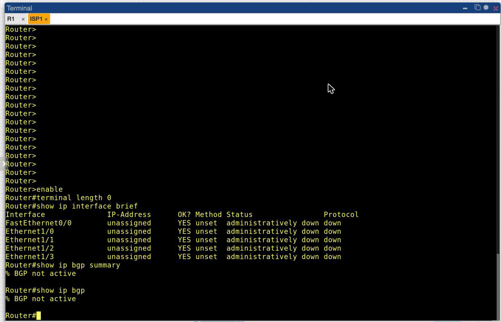

No ISP1 todas as interfaces estão `unassigned` e `administratively down`, e os dois comandos BGP retornam `% BGP not active`. O mesmo vale para ISP2 e ISP3. A verificação "em todos os roteadores dos ASs" pedida na Seção 9 do roteiro só é possível depois do Laboratório 7.

### 7. LAN da empresa

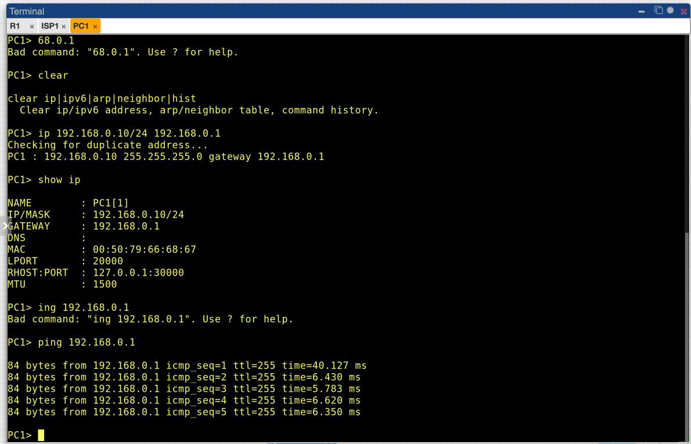

O PC1 (`192.168.0.10/24`, gateway `192.168.0.1`) alcança a interface `FastEthernet0/0` do R1 através do SW1, com 0% de perda. A rede interna está operacional. Ela não é anunciada via BGP por ser privada (RFC 1918).

## Parte 5 - A sessão com loopback

A empresa tem **dois enlaces físicos** com o ISP1. Se a sessão BGP fosse feita entre os endereços de um desses enlaces (por exemplo `10.1.0.1 ↔ 10.1.0.2`), a queda daquele enlace derrubaria a sessão, e com ela todas as rotas trocadas, mesmo com o segundo enlace funcionando. Fazer a sessão entre **loopbacks** desacopla a sessão BGP dos enlaces físicos: a loopback nunca cai enquanto o roteador estiver ligado, e o caminho até ela é resolvido pelas rotas estáticas, que usam qualquer um dos dois enlaces.

Três peças são necessárias para isso funcionar:

1. **Rotas estáticas para `10.10.10.10/32`**: o R1 precisa saber chegar à loopback do vizinho, que não é uma rede diretamente conectada. As duas estáticas em paralelo (P7) dão o caminho e a redundância.
2. **`update-source Loopback1`**: por padrão, o IOS usa como origem do TCP o endereço da interface de saída (`10.1.0.1` ou `10.1.0.5`). O ISP1 espera receber a conexão de `11.11.11.11` e recusaria uma origem diferente. O comando fixa a loopback como origem.
3. **`ebgp-multihop 2`**: por padrão, pacotes eBGP saem com TTL 1, pois o protocolo assume um vizinho diretamente conectado. Entre loopbacks o pacote atravessa o roteador do ISP1 antes de chegar à loopback dele, o que exige TTL 2. Além disso, sem esse comando o IOS nem tenta abrir a sessão com um vizinho eBGP fora de uma rede conectada.

Com o ISP2 nada disso é preciso: há um único enlace, e a vizinhança usa o próprio endereço da interface (`10.2.0.2`), com TTL 1 e origem automática.

## Parte 6 - Questões para análise

**1. Qual é a função do BGP nesse cenário?**

Permitir que a empresa, um sistema autônomo próprio (AS 1000), informe à Internet que é a origem do bloco `200.18.245.64/27`, e receba dos provedores as rotas para as demais redes. Sem o BGP, os provedores não teriam como aprender esse prefixo dinamicamente e a empresa não seria alcançável pelo seu endereçamento público. Com dois provedores (*multihoming*), o BGP também dá redundância de saída e o controle de por qual provedor o tráfego entra e sai.

**2. Por que a sessão com o ISP1 usa endereço de loopback?**

Porque existem dois enlaces físicos com o ISP1. A loopback não depende de nenhuma interface física: enquanto houver pelo menos um caminho até ela, a sessão BGP se mantém. Se a sessão fosse amarrada ao IP de um enlace, a falha desse enlace derrubaria a sessão e retiraria todas as rotas, mesmo com o outro enlace ativo.

**3. Por que foi necessário configurar `ebgp-multihop 2`?**

Porque o eBGP, por padrão, envia seus pacotes com TTL 1 e só aceita vizinhos em redes diretamente conectadas. A loopback `10.10.10.10` não está diretamente conectada ao R1. O pacote passa pelo ISP1 antes de ser entregue à loopback, um salto a mais. Com `ebgp-multihop 2` o TTL vai para 2 e o IOS passa a aceitar o vizinho remoto, como mostra a linha `External BGP neighbor may be up to 2 hops away` (P8).

**4. Qual a função do `update-source Loopback1`?**

Definir o endereço de origem da conexão TCP da sessão BGP. Sem ele, o R1 usaria o IP da interface de saída (`10.1.0.1` ou `10.1.0.5`, conforme o caminho escolhido), que não bate com o `neighbor 11.11.11.11` configurado no ISP1, e a sessão seria recusada. O comando garante que a sessão sempre parta de `11.11.11.11`, independentemente do enlace usado.

**5. Por que foi criada a rota `ip route 200.18.245.64 255.255.255.224 Null0`?**

Porque o comando `network` do BGP não cria rotas: ele só anuncia um prefixo que **já existe na tabela de roteamento com a mesma máscara**. A empresa não tem nenhuma interface com esse `/27` exato, então sem a rota para `Null0` o prefixo não entraria na tabela BGP. Apontar para `Null0` tem uma vantagem adicional: a rota é estável, não depende de nenhuma interface física, e evita *loops*. Pacotes para partes do bloco que não tenham uma rota mais específica dentro da empresa são descartados localmente em vez de voltar ao provedor. Os prints confirmam a ligação: a rota `S ... Null0` aparece em P7 e o prefixo aparece na tabela BGP em P6.

**6. Qual a diferença entre o pareamento com o ISP1 e com o ISP2?**

| | ISP1 (AS 100) | ISP2 (AS 200) |
| --- | --- | --- |
| Endereço do vizinho | `10.10.10.10` (loopback remota) | `10.2.0.2` (interface física) |
| Origem da sessão | `11.11.11.11` (`update-source Loopback1`) | `10.2.0.1` (automática) |
| TTL | 2 (`ebgp-multihop 2`) | 1 (padrão eBGP) |
| Alcance do vizinho | 2 rotas estáticas (ECMP) | rede diretamente conectada |
| Enlaces físicos | 2, redundantes | 1 |
| Resiliência | sobrevive à queda de um enlace | cai junto com o enlace |

Os dois usam autenticação MD5 (`password SENHA`) e são sessões eBGP, pois o R1 está em um AS diferente de ambos.

## Conclusão

O laboratório cumpriu o objetivo de configurar o BGP no roteador de borda da empresa. O R1 ficou com o processo no AS 1000, as duas vizinhanças eBGP com autenticação, a sessão com o ISP1 baseada em loopbacks (com `update-source`, `ebgp-multihop 2` e duas estáticas redundantes), e o prefixo `200.18.245.64/27` presente na tabela BGP, ancorado na rota para `Null0`.

O resultado mais instrutivo veio justamente do que **não** funcionou. O BGP é um protocolo de acordo entre as duas pontas: o R1 pode estar perfeitamente configurado e mesmo assim não anunciar nada. As sessões ficaram em `Active`/`Idle`, o prefixo ficou na tabela como válido mas sem *best path*, e o IOS registrou `Not advertised to any peer`. Diferente do RIP e do OSPF dos laboratórios anteriores, em que bastava habilitar o protocolo nas interfaces para os vizinhos se descobrirem, no BGP cada vizinho é declarado explicitamente nos dois lados, com AS, endereço, origem e senha correspondentes. 
