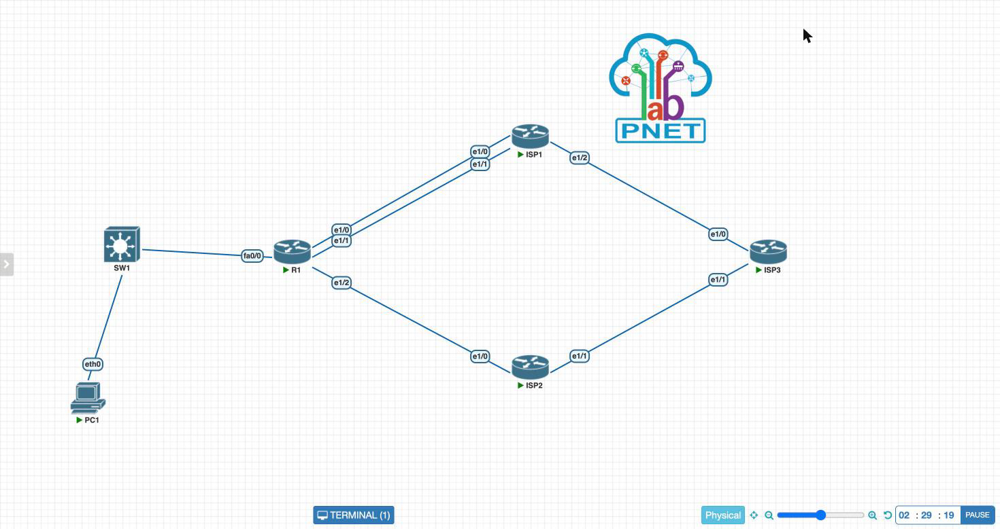
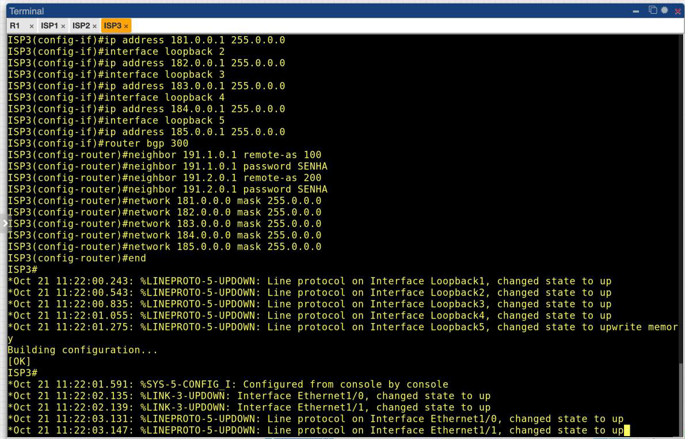
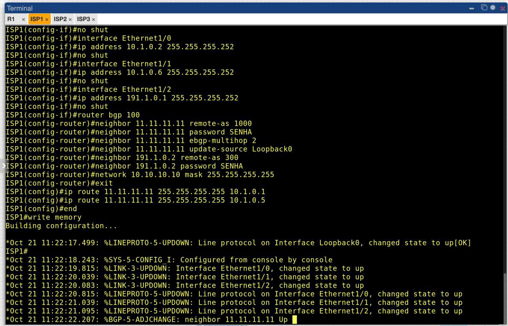
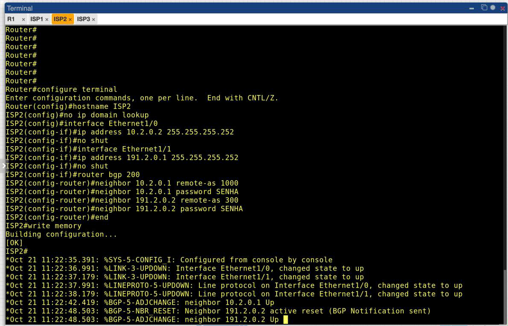
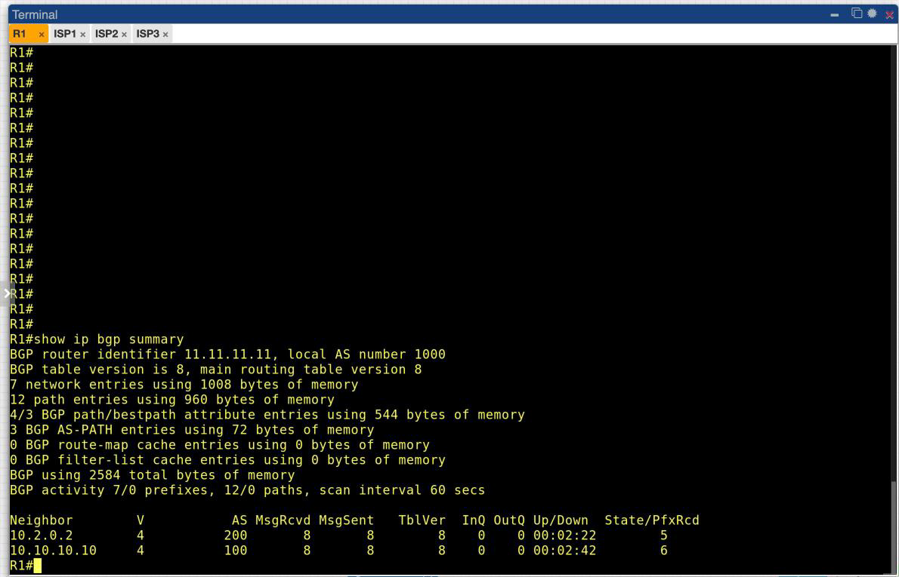
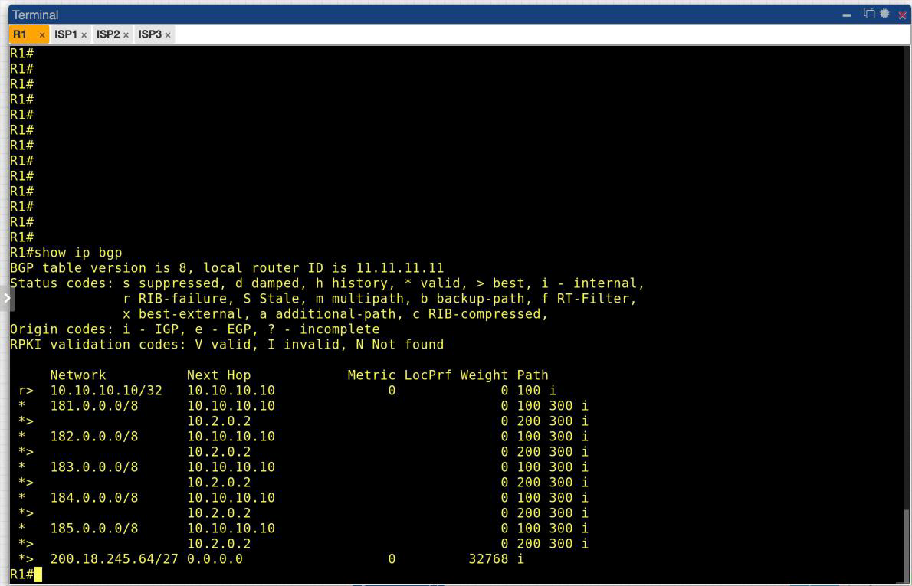
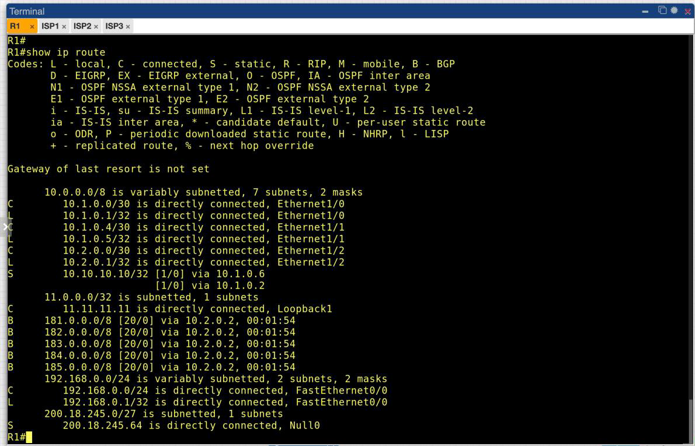
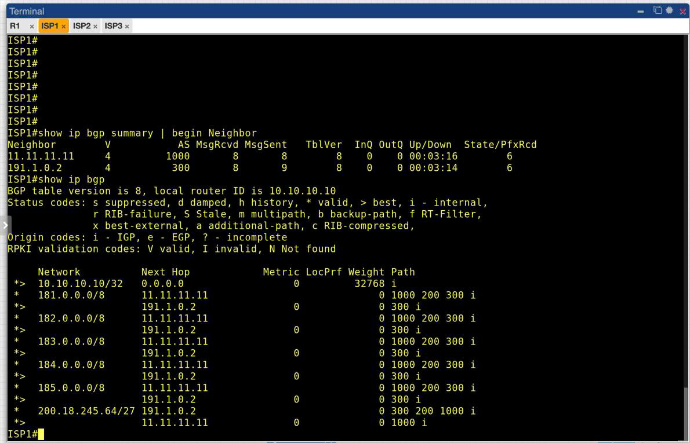
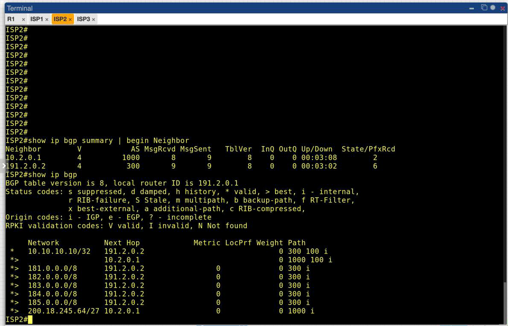
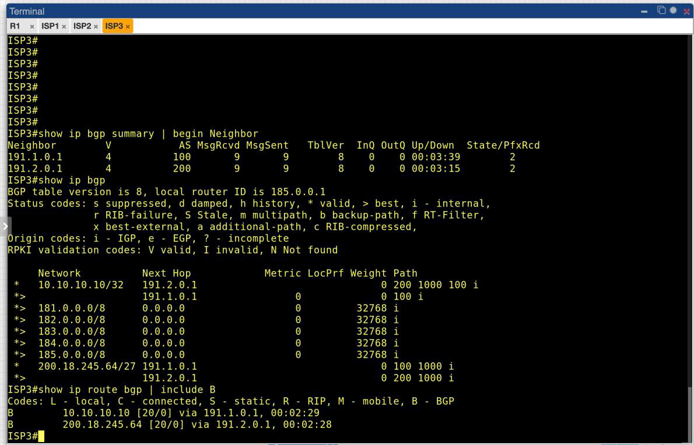

# Relatório 7 - Laboratório 7
**Arthur Choi Braga - 242014300**

Laboratório 07 - Configuração dos Provedores (BGP Externo)
Disciplina ENE0025 - Protocolos de Transporte e Roteamento

## Objetivo

Configurar os provedores ISP1 (AS 100), ISP2 (AS 200) e ISP3 (AS 300) para completar o cenário de BGP externo do Laboratório 6. O objetivo é estabelecer as quatro sessões eBGP, propagar o prefixo da empresa `200.18.245.64/27` até os provedores e levar as redes `181.0.0.0/8` a `185.0.0.0/8` até o R1.

## Parte 1 - Topologia



A topologia é a mesma do Laboratório 6, com o R1 já configurado (AS 1000, sessão com o ISP1 por loopback e com o ISP2 pelo enlace direto). Neste laboratório foram configurados os três provedores.

| Dispositivo | Interface | Endereço IP | Máscara | Enlace |
| --- | --- | --- | --- | --- |
| ISP1 | Loopback0 | 10.10.10.10 | 255.255.255.255 | Origem da sessão com o R1 |
| ISP1 | Et1/0 | 10.1.0.2 | 255.255.255.252 | R1 (enlace 1) |
| ISP1 | Et1/1 | 10.1.0.6 | 255.255.255.252 | R1 (enlace 2) |
| ISP1 | Et1/2 | 191.1.0.1 | 255.255.255.252 | ISP3 |
| ISP2 | Et1/0 | 10.2.0.2 | 255.255.255.252 | R1 |
| ISP2 | Et1/1 | 191.2.0.1 | 255.255.255.252 | ISP3 |
| ISP3 | Et1/0 | 191.1.0.2 | 255.255.255.252 | ISP1 |
| ISP3 | Et1/1 | 191.2.0.2 | 255.255.255.252 | ISP2 |
| ISP3 | Loopback1–5 | 181.0.0.1 … 185.0.0.1 | 255.0.0.0 | Prefixos externos de teste |

## Parte 2 - Configuração dos provedores

A ordem foi a recomendada pelo roteiro: ISP3, ISP1 e ISP2.

### 1. ISP3 (AS 300)

```bash
configure terminal
hostname ISP3
no ip domain lookup
interface Ethernet1/0
 ip address 191.1.0.2 255.255.255.252
 no shut
interface Ethernet1/1
 ip address 191.2.0.2 255.255.255.252
 no shut
interface loopback 1
 ip address 181.0.0.1 255.0.0.0
interface loopback 2
 ip address 182.0.0.1 255.0.0.0
interface loopback 3
 ip address 183.0.0.1 255.0.0.0
interface loopback 4
 ip address 184.0.0.1 255.0.0.0
interface loopback 5
 ip address 185.0.0.1 255.0.0.0
router bgp 300
 neighbor 191.1.0.1 remote-as 100
 neighbor 191.1.0.1 password SENHA
 neighbor 191.2.0.1 remote-as 200
 neighbor 191.2.0.1 password SENHA
 network 181.0.0.0 mask 255.0.0.0
 network 182.0.0.0 mask 255.0.0.0
 network 183.0.0.0 mask 255.0.0.0
 network 184.0.0.0 mask 255.0.0.0
 network 185.0.0.0 mask 255.0.0.0
end
write memory
```



As cinco loopbacks fazem o papel das redes externas. Elas criam as rotas conectadas `/8` que os comandos `network` exigem para anunciar cada prefixo.

### 2. ISP1 (AS 100)

```bash
configure terminal
hostname ISP1
no ip domain lookup
interface loopback 0
 ip address 10.10.10.10 255.255.255.255
interface Ethernet1/0
 ip address 10.1.0.2 255.255.255.252
 no shut
interface Ethernet1/1
 ip address 10.1.0.6 255.255.255.252
 no shut
interface Ethernet1/2
 ip address 191.1.0.1 255.255.255.252
 no shut
router bgp 100
 neighbor 11.11.11.11 remote-as 1000
 neighbor 11.11.11.11 password SENHA
 neighbor 11.11.11.11 ebgp-multihop 2
 neighbor 11.11.11.11 update-source Loopback0
 neighbor 191.1.0.2 remote-as 300
 neighbor 191.1.0.2 password SENHA
 network 10.10.10.10 mask 255.255.255.255
 exit
ip route 11.11.11.11 255.255.255.255 10.1.0.1
ip route 11.11.11.11 255.255.255.255 10.1.0.5
end
write memory
```



O ISP1 espelha a configuração do R1: a sessão sai da Loopback0 (`update-source`), aceita o vizinho a dois saltos (`ebgp-multihop 2`) e alcança a loopback `11.11.11.11` do R1 por duas rotas estáticas, uma por enlace. Assim que a configuração terminou, o log registrou `%BGP-5-ADJCHANGE: neighbor 11.11.11.11 Up`. A sessão por loopback que ficou em `Active` no Laboratório 6 se estabeleceu.

### 3. ISP2 (AS 200)

```bash
configure terminal
hostname ISP2
no ip domain lookup
interface Ethernet1/0
 ip address 10.2.0.2 255.255.255.252
 no shut
interface Ethernet1/1
 ip address 191.2.0.1 255.255.255.252
 no shut
router bgp 200
 neighbor 10.2.0.1 remote-as 1000
 neighbor 10.2.0.1 password SENHA
 neighbor 191.2.0.2 remote-as 300
 neighbor 191.2.0.2 password SENHA
end
write memory
```



As duas sessões do ISP2 subiram em poucos segundos. O `%BGP-5-NBR_RESET ... active reset` que aparece antes do `Up` com o ISP3 é a resolução normal de uma colisão: os dois lados abriram conexões TCP ao mesmo tempo, e o BGP descartou uma delas.

## Parte 3 - Verificação no R1

### 1. `show ip bgp summary`



```
Neighbor        V    AS MsgRcvd MsgSent   TblVer  InQ OutQ Up/Down  State/PfxRcd
10.2.0.2        4   200       8       8        8    0    0 00:02:22        5
10.10.10.10     4   100       8       8        8    0    0 00:02:42        6
```

As duas sessões estão estabelecidas: a coluna `State/PfxRcd` mostra um número de prefixos, não um estado. Logo após as sessões subirem, a tabela ainda ficou um tempo na versão 1 com poucos prefixos. É o modo *read-only* inicial do BGP, em que o roteador espera o *update-delay* antes de rodar a seleção de melhor caminho. Depois disso a tabela foi para a versão 8, com 7 redes e 12 caminhos.

Do ISP2 chegaram 5 prefixos (181 a 185) e do ISP1 chegaram 6 (os mesmos 5 mais a loopback `10.10.10.10/32`).

### 2. `show ip bgp`



```
     Network          Next Hop            Metric LocPrf Weight Path
 r>  10.10.10.10/32   10.10.10.10              0             0 100 i
 *   181.0.0.0/8      10.10.10.10                            0 100 300 i
 *>                   10.2.0.2                               0 200 300 i
 ...
 *>  200.18.245.64/27 0.0.0.0                  0         32768 i
```

- **Redes 181 a 185:** cada uma aparece por dois caminhos, via ISP1 (`100 300`) e via ISP2 (`200 300`). Os dois AS_PATH têm o mesmo comprimento, então o desempate vem dos critérios finais da seleção de melhor caminho. O IOS elegeu o ISP2 (`>`) para todas, e o caminho pelo ISP1 fica como alternativa pronta.
- **`200.18.245.64/27`:** agora aparece como `*>`, válido **e** melhor caminho. No Laboratório 6, sem vizinhos, ele ficava só `*`, com `no best path` e `Not advertised to any peer`. Com as sessões ativas, o prefixo passou a ser de fato anunciado.
- **`10.10.10.10/32`** aparece com `r` (*RIB-failure*): a rota foi aprendida por BGP, mas a tabela de roteamento já tem uma rota melhor para o mesmo destino, a estática (distância administrativa 1 contra 20 do eBGP). É o comportamento desejado: o caminho até o endereço da sessão continua sendo definido pelas estáticas, e não pelo próprio BGP que depende dele.

### 3. `show ip route`



```
S     10.10.10.10/32 [1/0] via 10.1.0.6
                     [1/0] via 10.1.0.2
B     181.0.0.0/8 [20/0] via 10.2.0.2, 00:01:54
B     182.0.0.0/8 [20/0] via 10.2.0.2, 00:01:54
B     183.0.0.0/8 [20/0] via 10.2.0.2, 00:01:54
B     184.0.0.0/8 [20/0] via 10.2.0.2, 00:01:54
B     185.0.0.0/8 [20/0] via 10.2.0.2, 00:01:54
S     200.18.245.64 is directly connected, Null0
```

As cinco redes externas entraram na tabela de roteamento como `B`, com distância administrativa 20 (eBGP) e próximo salto no ISP2, conforme a eleição da tabela BGP. Só o melhor caminho de cada prefixo é instalado. As estáticas para a loopback do ISP1 e a rota para `Null0` continuam presentes.

## Parte 4 - Verificação nos provedores

### 1. ISP1



O ISP1 tem as duas sessões ativas (R1 e ISP3), com 6 prefixos recebidos de cada uma. O prefixo da empresa aparece por dois caminhos:

```
 *   200.18.245.64/27 191.1.0.2     0 300 200 1000 i
 *>                   11.11.11.11   0 1000 i
```

O caminho direto (`1000`) foi eleito por ter o AS_PATH mais curto. O alternativo dá a volta pelo ISP3 e pelo ISP2.

A mesma tabela mostra um efeito colateral importante. O ISP1 recebe do R1 as redes 181–185 com AS_PATH `1000 200 300`: a empresa está **reanunciando ao ISP1 as rotas que aprendeu do ISP2**. Por padrão, o eBGP repassa a todos os vizinhos tudo o que elegeu. Sem filtros, o AS 1000 se oferece como caminho de trânsito entre seus dois provedores. Aqui o ISP1 não usa esse caminho porque tem um mais curto, mas em produção isso se evita com filtros de saída, anunciando só o prefixo próprio.

### 2. ISP2



O ISP2 tem as duas sessões ativas. Recebeu 2 prefixos do R1 (`200.18.245.64/27` e, por trânsito, `10.10.10.10/32` com caminho `1000 100`) e 6 do ISP3. O prefixo da empresa está eleito pelo caminho direto (`*> 200.18.245.64/27 10.2.0.1 ... 1000 i`).

### 3. ISP3



O ISP3, que representa "o resto da Internet", tem sessões com ISP1 e ISP2 e conhece o prefixo da empresa por dois caminhos de mesmo comprimento:

```
 *   200.18.245.64/27 191.1.0.1     0 100 1000 i
 *>                   191.2.0.1     0 200 1000 i
```

O `show ip route bgp` confirma a rota instalada: `B 200.18.245.64 [20/0] via 191.2.0.1`. O bloco público da empresa está alcançável a partir de um AS que não tem nenhuma ligação direta com ela, por qualquer um dos dois provedores. É o objetivo do *multihoming*.

## Parte 5 - Resultado

| Item esperado (Seção 8 do roteiro) | Resultado |
| --- | --- |
| Sessão R1 ↔ ISP1 Established | ✔ via loopbacks `11.11.11.11` ↔ `10.10.10.10` |
| Sessão R1 ↔ ISP2 Established | ✔ |
| Sessão ISP1 ↔ ISP3 Established | ✔ |
| Sessão ISP2 ↔ ISP3 Established | ✔ |
| R1 com rotas para 181–185/8 | ✔ dois caminhos cada, melhor via ISP2 |
| Prefixo `200.18.245.64/27` nos provedores | ✔ ISP1, ISP2 e ISP3 |

## Conclusão

Com os três provedores configurados, o cenário de BGP externo ficou completo: as quatro sessões eBGP foram estabelecidas e o prefixo `200.18.245.64/27`, que no Laboratório 6 ficava parado na tabela do R1 sem *best path*, passou a ser eleito e anunciado até o ISP3. No sentido inverso, o R1 aprendeu as cinco redes externas por dois provedores e instalou o melhor caminho de cada uma.

O laboratório deixa visível o que o BGP faz e o que ele não faz sozinho. Ele dá redundância de forma natural: todo destino tem um caminho alternativo já presente na tabela BGP. A escolha entre caminhos de mesmo comprimento, porém, fica com os critérios de desempate, e não com uma decisão da empresa. Além disso, sem filtros, o AS 1000 reanuncia as rotas de um provedor para o outro e se torna trânsito. Controlar por qual provedor o tráfego sai e entra, e o que cada vizinho recebe, exige políticas de roteamento, que são o tema do próximo laboratório.
