# Relatório 8 - Laboratório 8
**Arthur Choi Braga - 242014300**

Laboratório 08 - Políticas BGP e integração com OSPF
Disciplina ENE0025 - Protocolos de Transporte e Roteamento

## Objetivo

Sobre o cenário dos Laboratórios 6 e 7, os objetivos são:

- usar o **OSPF** como protocolo do domínio interno da empresa (AS 1000);
- definir por política BGP o **ISP1** como saída principal e o **ISP2** como contingência;
- propagar para o domínio interno **apenas a rota default**;
- verificar o comportamento em caso de falha dos enlaces com o ISP1.

## Parte 1 - Topologia

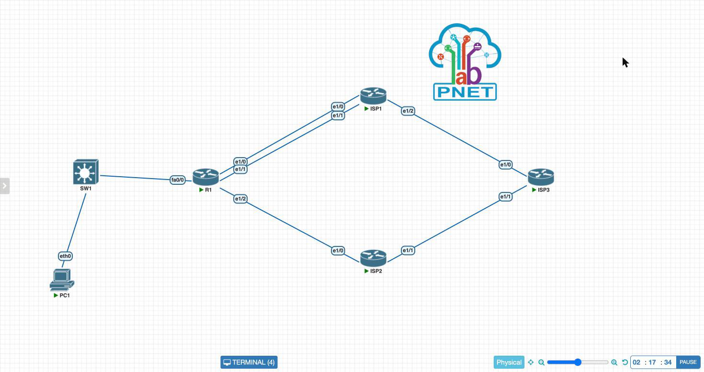

A topologia e a configuração de interfaces e das sessões eBGP dos laboratórios anteriores foram mantidas. Todas as configurações deste laboratório foram feitas no R1.

## Parte 2 - Configuração

### 1. OSPF interno

```bash
configure terminal
router ospf 10
 network 192.168.0.0 0.0.0.255 area 0
 network 11.11.11.11 0.0.0.0 area 0
end
```

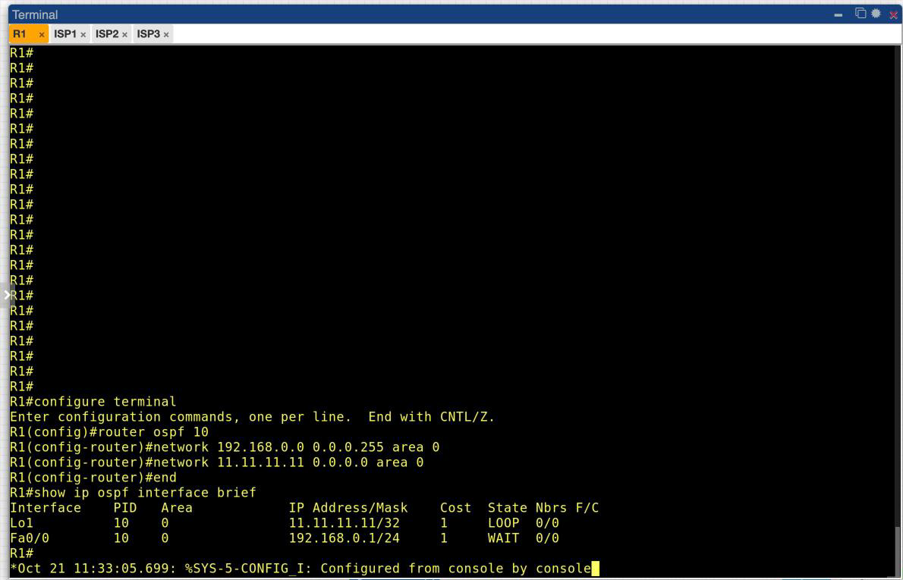

O OSPF foi habilitado na LAN (`Fa0/0`, `192.168.0.0/24`) e na Loopback1 (`11.11.11.11/32`), as duas interfaces que pertencem ao domínio interno. Os enlaces com os provedores ficaram de fora: neles quem trabalha é o BGP.

### 2. BGP

```bash
configure terminal
router bgp 1000
 neighbor 10.10.10.10 remote-as 100
 neighbor 10.10.10.10 password SENHA
 neighbor 10.10.10.10 ebgp-multihop 2
 neighbor 10.10.10.10 update-source Loopback1
 neighbor 10.2.0.2 remote-as 200
 neighbor 10.2.0.2 password SENHA
 network 200.18.245.64 mask 255.255.255.224
 exit
ip route 10.10.10.10 255.255.255.255 Ethernet1/0 10.1.0.2
ip route 10.10.10.10 255.255.255.255 Ethernet1/1 10.1.0.6
ip route 200.18.245.64 255.255.255.224 Null0
end
```

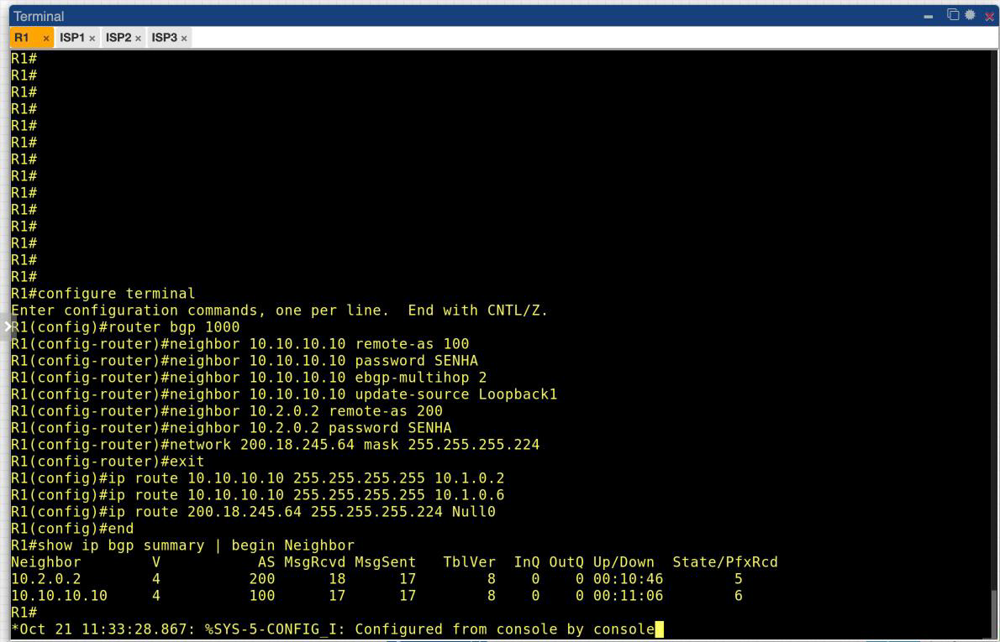

As duas sessões eBGP estão estabelecidas, com 5 prefixos recebidos do ISP2 e 6 do ISP1. As estáticas para a loopback do ISP1 indicam a interface de saída **e** o próximo salto. O motivo está na Parte 4.

### 3. Política: ISP1 principal, ISP2 contingência

```bash
configure terminal
router bgp 1000
 neighbor 10.10.10.10 weight 200
 neighbor 10.2.0.2 weight 100
end
clear ip bgp * soft in
```

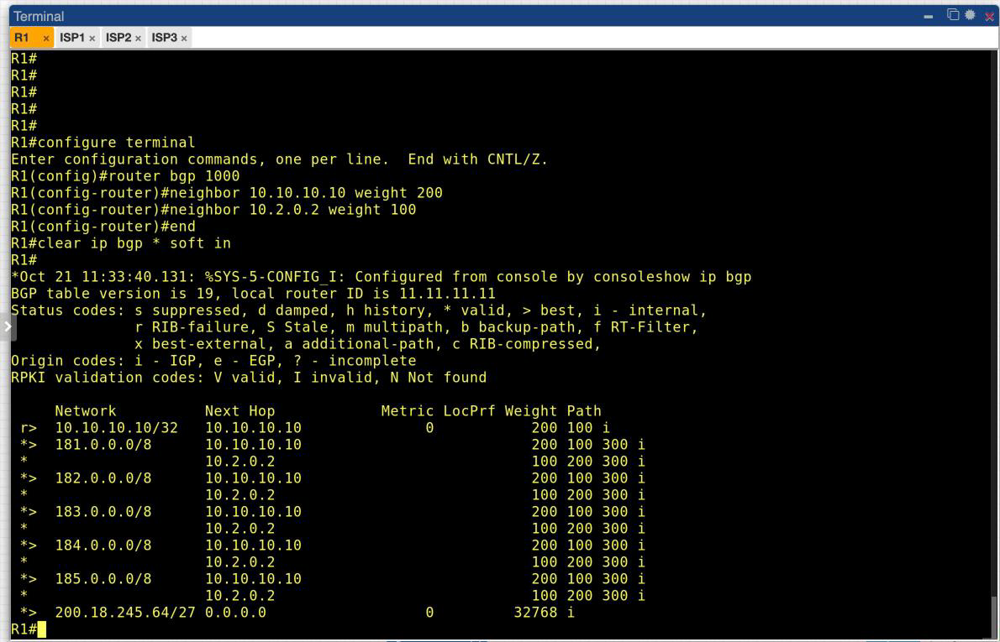

```
     Network          Next Hop            Metric LocPrf Weight Path
 *>  181.0.0.0/8      10.10.10.10                          200 100 300 i
 *                    10.2.0.2                             100 200 300 i
```

O *weight* é o primeiro critério da seleção de melhor caminho no IOS. É local ao roteador e não é anunciado a nenhum vizinho. Antes da política, as redes 181–185 eram alcançadas pelo ISP2: os dois caminhos tinham AS_PATH de mesmo tamanho e o desempate favorecia o ISP2. Com weight 200 para o ISP1 e 100 para o ISP2, as cinco redes passaram a sair pelo **ISP1**, e o ISP2 permanece na tabela como alternativa. O `clear ip bgp * soft in` reprocessa as rotas já recebidas sem derrubar as sessões, para que o novo weight seja aplicado a elas.

O weight controla só a **saída** do tráfego. A escolha do caminho de entrada é feita pelos outros ASes e exigiria atributos que eles enxergam, como AS_PATH *prepend*.

### 4. Integração BGP–OSPF: apenas a rota default

```bash
configure terminal
ip route 0.0.0.0 0.0.0.0 10.10.10.10
ip route 0.0.0.0 0.0.0.0 10.2.0.2 5
router ospf 10
 default-information originate
end
```

A default principal aponta para a loopback do ISP1. A segunda, com distância administrativa 5, é uma **default flutuante** pelo ISP2: só entra na tabela se a principal sair.

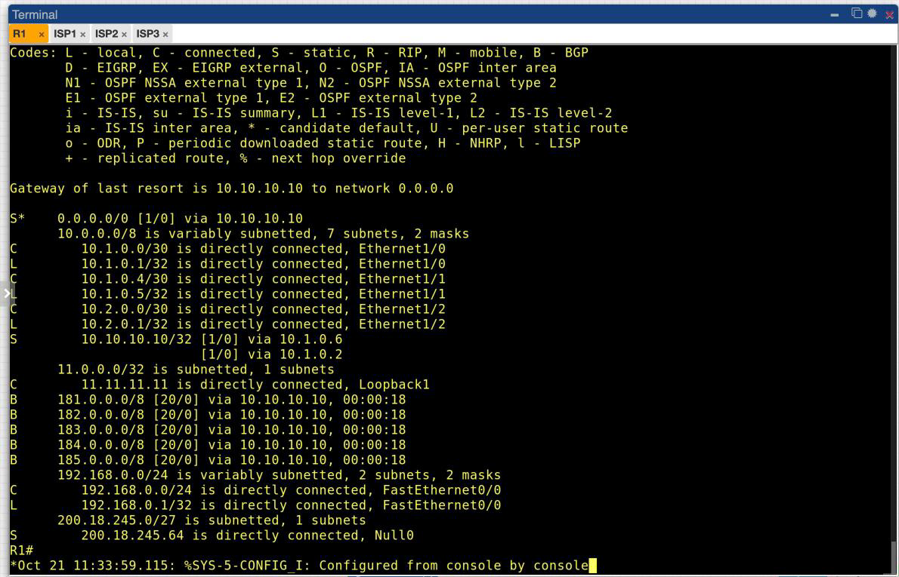

```
Gateway of last resort is 10.10.10.10 to network 0.0.0.0
S*    0.0.0.0/0 [1/0] via 10.10.10.10
B     181.0.0.0/8 [20/0] via 10.10.10.10
...
```

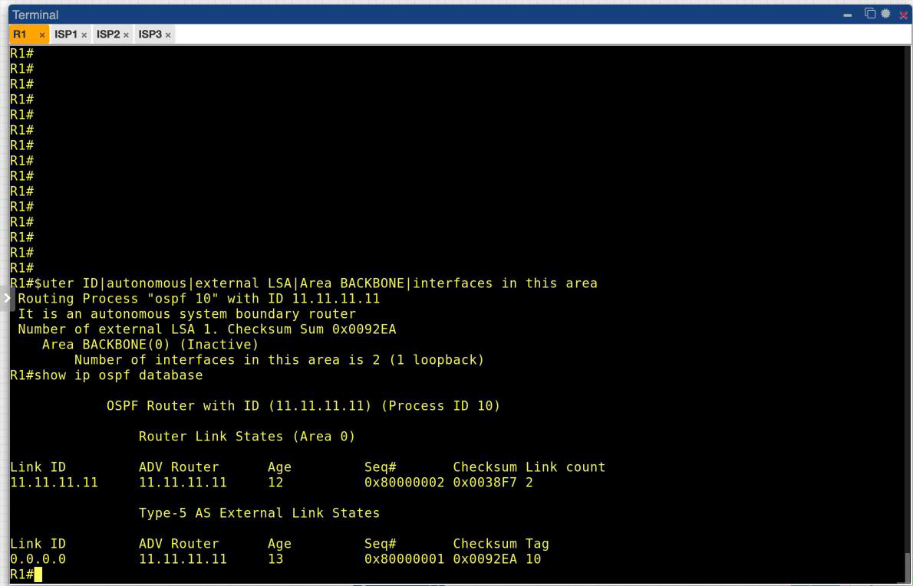

O `show ip ospf` mostra que o R1 passou a ser **ASBR** (*autonomous system boundary router*) e tem exatamente **1 LSA externo**. O `show ip ospf database` confirma que o único LSA Type-5 é o `0.0.0.0`. As redes 181–185 continuam só na tabela do R1 (código `B`) e não foram injetadas no OSPF. Um roteador interno da empresa receberia apenas `O*E2 0.0.0.0/0` apontando para o R1, independentemente de quantos prefixos a borda conheça.

## Parte 3 - Teste de falha

### 1. Queda de um enlace com o ISP1

```bash
interface Ethernet1/0
 shutdown
```

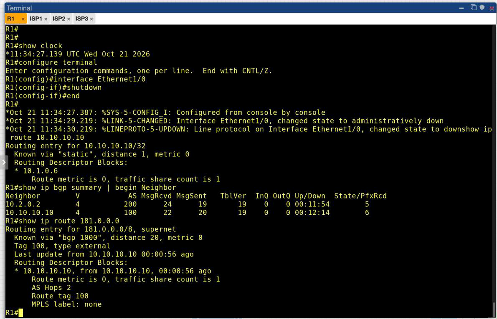

Com o `Ethernet1/0` desligado, a rota para `10.10.10.10/32` passou a ter só o próximo salto `10.1.0.6`, pelo enlace que restou. A sessão BGP com o ISP1 **não caiu** (`Up/Down 00:12:14`, 6 prefixos), e as redes externas continuaram saindo pelo ISP1. Esse é o ganho da sessão por loopback: ela não depende de nenhuma interface física específica.

### 2. Perda total do ISP1

```bash
interface Ethernet1/1
 shutdown
```

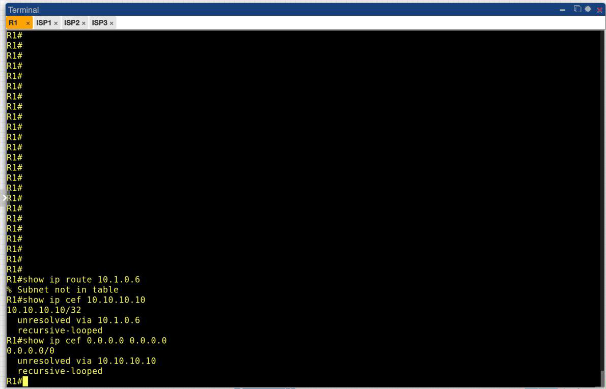

Este print foi capturado com a primeira versão das estáticas para a loopback do ISP1, que usavam só o próximo salto (`ip route 10.10.10.10 255.255.255.255 10.1.0.2` e `10.1.0.6`). Com os dois enlaces fora, o BGP reagiu corretamente e as redes 181–185 passaram para o ISP2. A rota default, porém, ficou presa: `10.1.0.6` deixou de ser uma rede conectada e passou a ser resolvida pela própria default, que aponta para `10.10.10.10`, que por sua vez é resolvido por `10.1.0.6`. O CEF marcou as duas rotas como `recursive-looped`, mas elas continuaram na tabela de roteamento. Com isso, a default principal (AD 1) bloqueava a flutuante pelo ISP2, e o domínio interno ficaria sem saída.

Indicar também a interface de saída nas estáticas (`Ethernet1/0 10.1.0.2` e `Ethernet1/1 10.1.0.6`, como na Parte 2) faz com que elas sejam removidas quando a interface cai. A default via `10.10.10.10` deixa de ser resolvível e a flutuante assume.

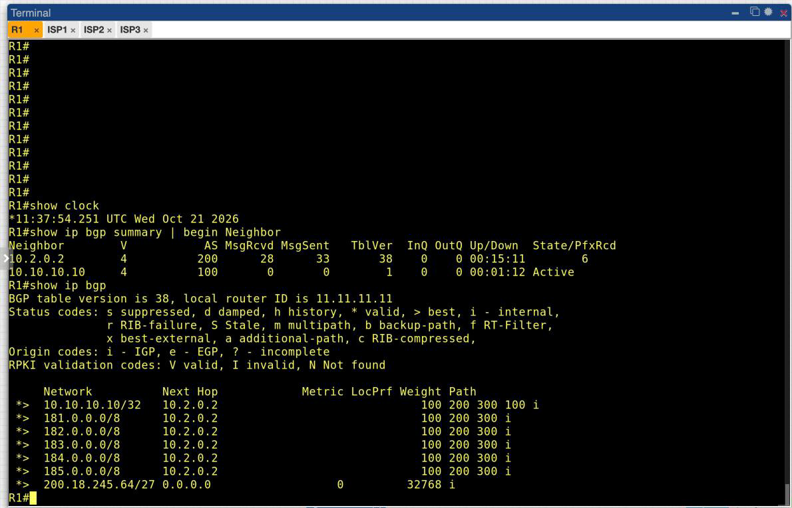

Às 11:37:54 a sessão com o ISP1 já estava encerrada (`Active`), por expiração do *hold timer*. A tabela BGP passou a ter apenas os caminhos do ISP2 (weight 100), inclusive para `10.10.10.10/32`, agora alcançado por `200 300 100`.

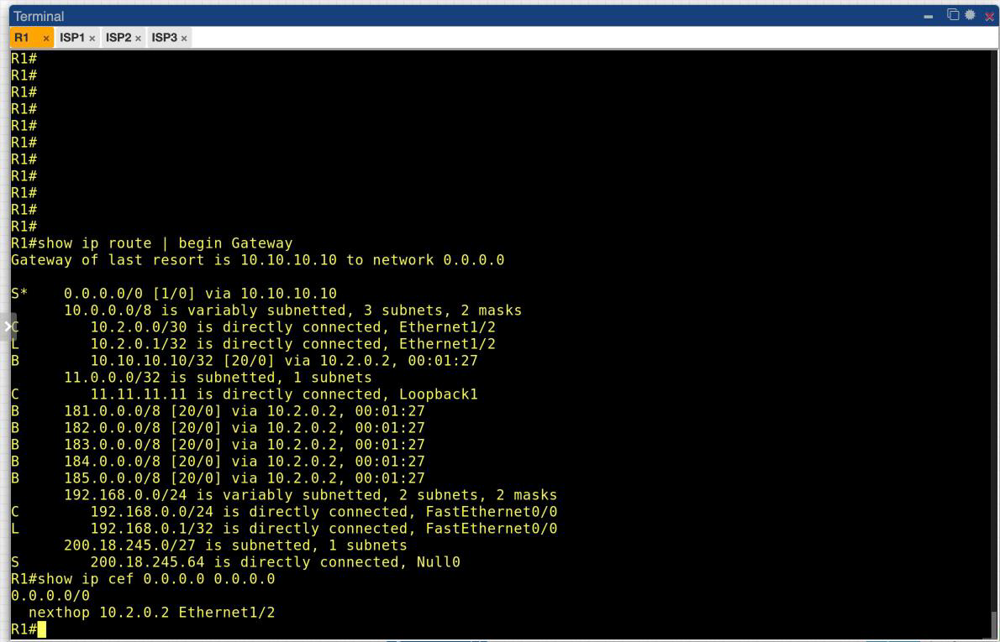

```
S*    0.0.0.0/0 [1/0] via 10.10.10.10
B     10.10.10.10/32 [20/0] via 10.2.0.2
B     181.0.0.0/8 [20/0] via 10.2.0.2
...
R1# show ip cef 0.0.0.0 0.0.0.0
0.0.0.0/0
  nexthop 10.2.0.2 Ethernet1/2
```

A saída migrou por completo para o ISP2. A default ainda aparece como `via 10.10.10.10`, mas esse endereço agora é resolvido pela rota BGP aprendida do ISP2, e o CEF encaminha de fato por `10.2.0.2`. O LSA de default no OSPF não muda: para o domínio interno a falha é transparente, porque a saída continua sendo "o R1".

### 3. Restauração

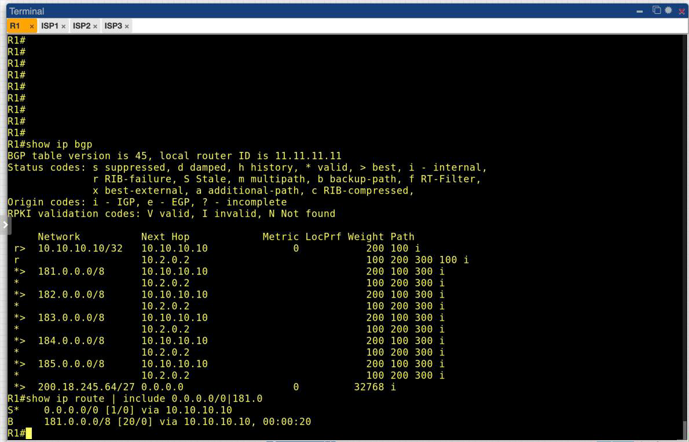

Com `no shutdown` nos dois enlaces às 11:38:22, a sessão com o ISP1 voltou às 11:38:41. As redes 181–185 retornaram ao ISP1 (`*>` com weight 200), sem nenhuma intervenção manual. A default voltou a ser resolvida pelas estáticas dos enlaces diretos.

## Parte 4 - Questões para análise

**1. Qual é o papel do OSPF neste laboratório?**

Representar o roteamento **interno** da empresa: distribuir as redes do AS 1000 (LAN e loopback) e levar aos roteadores internos uma única informação sobre o mundo externo, a rota default originada pelo R1.

**2. Qual é o papel do BGP neste laboratório?**

Trocar rotas com os provedores na **borda**: anunciar o prefixo público `200.18.245.64/27`, receber as rotas externas e aplicar a política de saída (weight), decidindo por qual provedor o tráfego sai.

**3. Por que o bloco 200.18.245.64/27 é anunciado externamente, mas a rede 192.168.0.0/24 não?**

Porque `200.18.245.64/27` é um bloco público, roteável na Internet e atribuído à empresa. `192.168.0.0/24` é endereçamento privado (RFC 1918): pode existir em milhares de redes ao mesmo tempo e não é roteável na Internet. Hosts da LAN só saem para a Internet através de NAT para o bloco público.

**4. Qual a vantagem de formar a sessão BGP com o ISP1 por loopback?**

A sessão deixa de depender de um enlace físico. No teste, a queda do `Ethernet1/0` não derrubou a sessão nem alterou a tabela BGP, porque a loopback continuou alcançável pelo outro enlace.

**5. Qual é a função do comando `update-source Loopback1`?**

Fazer o R1 usar `11.11.11.11` como endereço de origem da conexão TCP da sessão. É o endereço que o ISP1 tem configurado como vizinho, e sem o comando o R1 usaria o IP da interface de saída.

**6. Qual é a função do comando `ebgp-multihop 2`?**

Permitir a sessão eBGP com um vizinho que não está diretamente conectado. O TTL dos pacotes BGP passa de 1 para 2, o suficiente para chegar à loopback do ISP1, um salto além da interface física.

**7. Como verificar, no `show ip bgp`, qual ISP está sendo preferido?**

Pelo marcador `>` na coluna de status, que indica o melhor caminho de cada prefixo, junto com o *Next Hop* (`10.10.10.10` para o ISP1, `10.2.0.2` para o ISP2) e o primeiro AS do *Path* (`100` ou `200`). A coluna *Weight* mostra o motivo da escolha (200 contra 100).

**8. Por que é mais adequado propagar apenas a default route no OSPF?**

Porque o domínio interno não precisa saber **qual** caminho externo é o melhor, só que a saída é o R1. Redistribuir as rotas BGP no OSPF colocaria toda a tabela externa em todos os roteadores internos (na Internet real são centenas de milhares de prefixos). Isso custa memória e CPU e espalha recálculos de SPF a cada oscilação externa. Com a default, o banco OSPF ficou com um único LSA externo (P6), e a falha do ISP1 não exigiu nenhuma mudança no domínio interno.

**9. O que acontece quando o enlace principal com o ISP1 falha?**

Com a queda de **um** enlace, nada muda para o tráfego: a loopback do ISP1 continua alcançável pelo outro enlace e a sessão se mantém. Com a perda dos **dois**, o BGP elege os caminhos do ISP2 para as redes externas, a sessão com o ISP1 é encerrada pelo *hold timer*, e a default passa a encaminhar pelo ISP2. Quando os enlaces voltam, a sessão é restabelecida em segundos e o weight devolve a preferência ao ISP1. O teste também mostrou que as estáticas para a loopback do ISP1 precisam indicar a interface de saída: só com próximo salto, elas viram um loop recursivo com a default e impedem a troca de saída.

**10. Qual a diferença entre usar OSPF para a rede interna e BGP para a borda?**

O OSPF busca o **caminho mais curto** dentro de um domínio administrativo único, converge rápido e conhece a topologia completa da área. O BGP troca **alcançabilidade e políticas** entre domínios independentes: não conhece a topologia dos outros ASes, decide por atributos (weight, AS_PATH etc.) e foi feito para escalar até a tabela da Internet. Cada um resolve um problema diferente, e a integração por default route os mantém separados.

## Conclusão

O R1 passou a combinar os dois protocolos com papéis bem separados. O OSPF cuida do domínio interno e recebe da borda apenas a rota default. O BGP cuida dos provedores, anuncia o bloco público e aplica a política de saída. Com o weight, o ISP1 virou o caminho principal para todos os prefixos externos e o ISP2 ficou como contingência.

O teste de falha confirmou a redundância em dois níveis. A perda de um enlace com o ISP1 foi absorvida pela sessão por loopback, sem impacto. A perda total do ISP1 levou a saída para o ISP2, e na restauração a preferência voltou sozinha ao ISP1. Para isso funcionar, as estáticas que sustentam a sessão por loopback precisam indicar a interface de saída, senão a default fica presa a um caminho que não existe mais.
